# DRIFT final campaign: deep analysis

Rebuilt from saved per-question records by `python -m analysis.final_report`.

## 0. What was run, and is it clean

| benchmark | cells | models | questions per cell | prompt versions | relation matching | records with context recovered | extraction failures after retry |
|---|---|---|---|---|---|---|---|
| MQuAKE-T | 35 / 35 | 5 | 96 | 1 | normalized | 86% | 0 |
| FactConsolidation | 35 / 35 | 5 | 100 | 1 | normalized | 86% | 0 |
| ConvoMem | 35 / 35 | 5 | 100 | 1 | normalized | 86% | 0 |

Every cell of a benchmark should show one prompt version and one relation-matching mode. Context recovery is the share of answers whose retrieved facts could be mapped back to text, which the mechanism analysis (Section 2) needs.

**Data artefact in MQuAKE-T.** 7 questions have their superseded value stated again, about the same subject, in a session after the update, so memory itself says the old value is current. They are kept in the main tables and removed in the 'MQuAKE-T (clean)' rows. Questions: What is the name of the current head of state in Honduras?; What is the name of the current head of state in Kenya?; What is the name of the current head of state in Malawi?; What is the name of the current head of the Honduras government?; What is the name of the current head of the Kenya government?; What is the name of the current head of the Malawi government?; What is the name of the current head of the New York City government?

**Data artefact in FactConsolidation.** 1 questions have their superseded value stated again, about the same subject, in a session after the update, so memory itself says the old value is current. They are kept in the main tables and removed in the 'FactConsolidation (clean)' rows. Questions: What is the name of the current head of state in United States of America?

Contradiction detection coverage, from the offline preflight (questions whose superseded value sits in a closed fact):

| benchmark | questions with a superseded answer | detected (exact) | detected (normalised) | stored but missed | current answer wrongly closed |
|---|---|---|---|---|---|
| mquake_t_sh | 96 | 95 | 95 | 1 | 0 |
| factconsolidation_sh_6k | 65 | 59 | 60 | 5 | 0 |
| convomem_changing | 100 | 16 | 14 | 24 | 0 |

## 1. Main results

### MQuAKE-T

Each cell: accuracy [95% interval] / staleness rate.

| policy | Claude Sonnet 5.5 | GPT-6.1 Sol | Gemini 3.8 Flash | Llama 3.1 8B | Qwen3 14B |
|---|---|---|---|---|---|
| NOMEM | 0.000 [0.00, 0.00] / 0.000 | 0.000 [0.00, 0.00] / 0.000 | 0.000 [0.00, 0.00] / 0.000 | 0.000 [0.00, 0.00] / 0.000 | 0.031 [0.00, 0.07] / 0.000 |
| P0 | 0.979 [0.95, 1.00] / 0.010 | 0.990 [0.97, 1.00] / 0.010 | 0.990 [0.97, 1.00] / 0.010 | 0.771 [0.69, 0.84] / 0.208 | 0.948 [0.90, 0.99] / 0.021 |
| P1 | 0.896 [0.83, 0.95] / 0.010 | 0.896 [0.83, 0.95] / 0.010 | 0.885 [0.82, 0.95] / 0.010 | 0.719 [0.62, 0.81] / 0.125 | 0.833 [0.75, 0.91] / 0.021 |
| P2 | 0.990 [0.97, 1.00] / 0.000 | 0.990 [0.97, 1.00] / 0.010 | 0.990 [0.97, 1.00] / 0.010 | 0.979 [0.95, 1.00] / 0.010 | 0.979 [0.95, 1.00] / 0.000 |
| P3 | 0.833 [0.76, 0.91] / 0.125 | 0.812 [0.73, 0.89] / 0.146 | 0.802 [0.72, 0.88] / 0.146 | 0.677 [0.58, 0.77] / 0.250 | 0.792 [0.71, 0.86] / 0.156 |
| P4 | 0.969 [0.93, 1.00] / 0.021 | 0.969 [0.93, 1.00] / 0.031 | 0.958 [0.92, 0.99] / 0.031 | 0.771 [0.69, 0.84] / 0.219 | 0.906 [0.84, 0.96] / 0.031 |
| P5 | 0.792 [0.71, 0.86] / 0.198 | 0.781 [0.70, 0.85] / 0.219 | 0.792 [0.71, 0.86] / 0.208 | 0.625 [0.53, 0.72] / 0.312 | 0.760 [0.68, 0.84] / 0.198 |

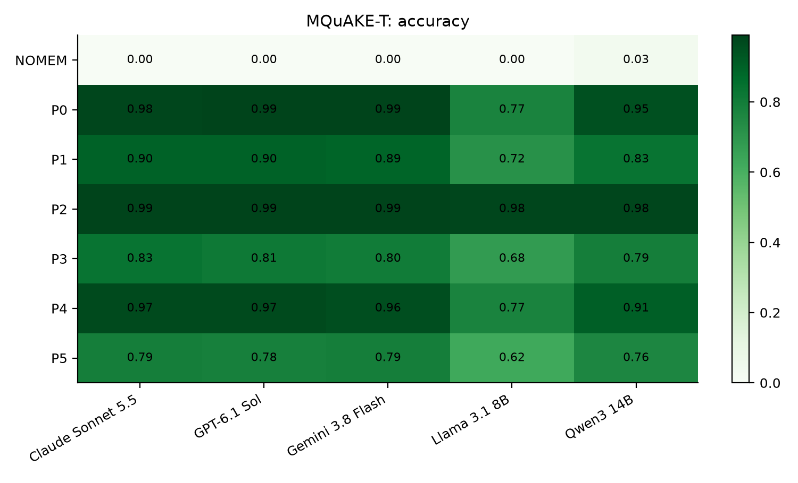

*MQuAKE-T: accuracy by policy and model*

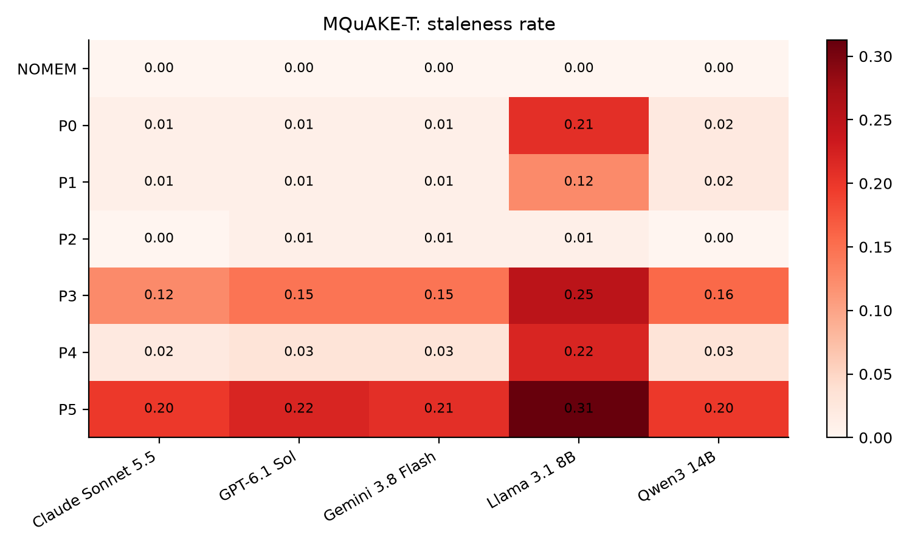

*MQuAKE-T: staleness rate by policy and model*

### MQuAKE-T (clean)

Each cell: accuracy [95% interval] / staleness rate.

| policy | Claude Sonnet 5.5 | GPT-6.1 Sol | Gemini 3.8 Flash | Llama 3.1 8B | Qwen3 14B |
|---|---|---|---|---|---|
| NOMEM | 0.000 [0.00, 0.00] / 0.000 | 0.000 [0.00, 0.00] / 0.000 | 0.000 [0.00, 0.00] / 0.000 | 0.000 [0.00, 0.00] / 0.000 | 0.034 [0.00, 0.08] / 0.000 |
| P0 | 0.989 [0.97, 1.00] / 0.000 | 1.000 [1.00, 1.00] / 0.000 | 1.000 [1.00, 1.00] / 0.000 | 0.753 [0.66, 0.84] / 0.225 | 0.955 [0.91, 0.99] / 0.011 |
| P1 | 0.899 [0.83, 0.96] / 0.000 | 0.899 [0.83, 0.96] / 0.000 | 0.888 [0.82, 0.94] / 0.000 | 0.719 [0.62, 0.81] / 0.124 | 0.831 [0.75, 0.91] / 0.011 |
| P2 | 1.000 [1.00, 1.00] / 0.000 | 1.000 [1.00, 1.00] / 0.000 | 1.000 [1.00, 1.00] / 0.000 | 0.978 [0.94, 1.00] / 0.011 | 0.989 [0.97, 1.00] / 0.000 |
| P3 | 0.831 [0.75, 0.91] / 0.135 | 0.820 [0.74, 0.90] / 0.157 | 0.820 [0.74, 0.90] / 0.157 | 0.674 [0.57, 0.78] / 0.270 | 0.798 [0.71, 0.88] / 0.169 |
| P4 | 0.978 [0.94, 1.00] / 0.022 | 0.978 [0.94, 1.00] / 0.022 | 0.966 [0.92, 1.00] / 0.022 | 0.753 [0.66, 0.84] / 0.236 | 0.910 [0.84, 0.97] / 0.022 |
| P5 | 0.854 [0.78, 0.92] / 0.135 | 0.843 [0.76, 0.91] / 0.157 | 0.854 [0.78, 0.92] / 0.146 | 0.663 [0.56, 0.76] / 0.270 | 0.820 [0.74, 0.90] / 0.135 |

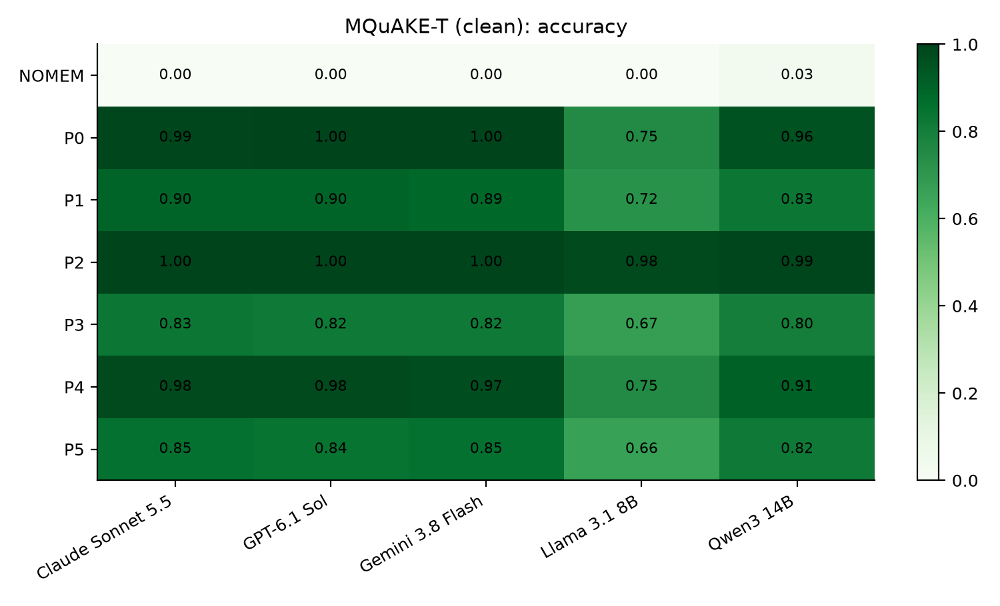

*MQuAKE-T (clean): accuracy by policy and model*

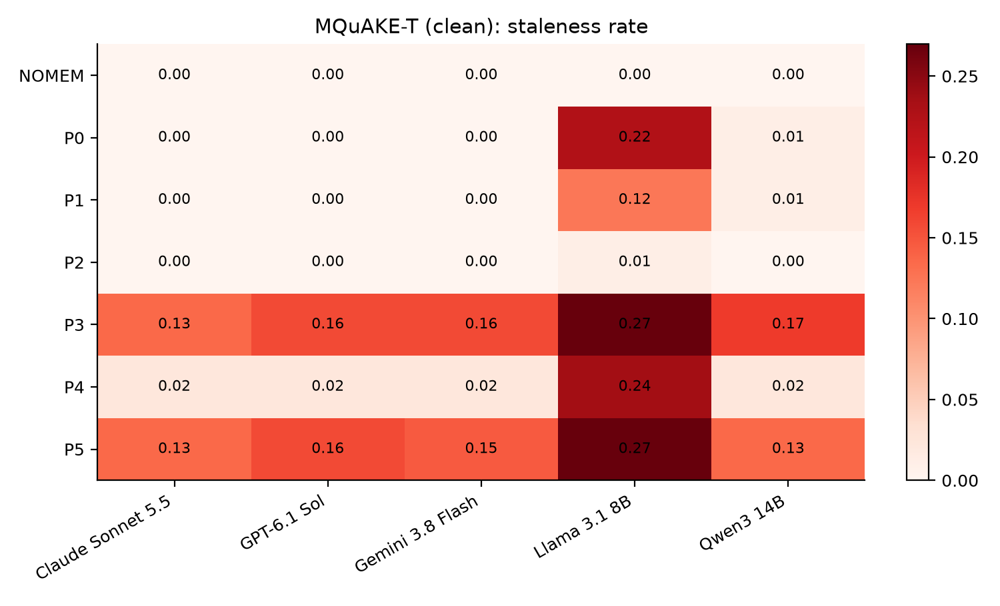

*MQuAKE-T (clean): staleness rate by policy and model*

### FactConsolidation

Each cell: accuracy [95% interval] / staleness rate.

| policy | Claude Sonnet 5.5 | GPT-6.1 Sol | Gemini 3.8 Flash | Llama 3.1 8B | Qwen3 14B |
|---|---|---|---|---|---|
| NOMEM | 0.000 [0.00, 0.00] / 0.000 | 0.000 [0.00, 0.00] / 0.000 | 0.000 [0.00, 0.00] / 0.000 | 0.000 [0.00, 0.00] / 0.000 | 0.010 [0.00, 0.03] / 0.030 |
| P0 | 0.810 [0.73, 0.88] / 0.000 | 0.850 [0.78, 0.92] / 0.000 | 0.850 [0.78, 0.92] / 0.000 | 0.290 [0.20, 0.38] / 0.340 | 0.570 [0.47, 0.67] / 0.020 |
| P1 | 0.630 [0.54, 0.73] / 0.030 | 0.640 [0.55, 0.74] / 0.000 | 0.640 [0.55, 0.74] / 0.000 | 0.400 [0.30, 0.50] / 0.140 | 0.550 [0.45, 0.65] / 0.020 |
| P2 | 0.860 [0.79, 0.92] / 0.000 | 0.860 [0.79, 0.92] / 0.000 | 0.860 [0.79, 0.92] / 0.000 | 0.620 [0.53, 0.71] / 0.060 | 0.770 [0.68, 0.85] / 0.000 |
| P3 | 0.640 [0.55, 0.73] / 0.120 | 0.670 [0.58, 0.76] / 0.130 | 0.660 [0.57, 0.75] / 0.120 | 0.300 [0.21, 0.39] / 0.350 | 0.440 [0.35, 0.54] / 0.120 |
| P4 | 0.480 [0.38, 0.58] / 0.270 | 0.510 [0.41, 0.61] / 0.270 | 0.550 [0.46, 0.65] / 0.240 | 0.250 [0.17, 0.34] / 0.460 | 0.290 [0.20, 0.38] / 0.430 |
| P5 | 0.740 [0.65, 0.82] / 0.050 | 0.810 [0.73, 0.88] / 0.030 | 0.800 [0.72, 0.87] / 0.040 | 0.290 [0.21, 0.38] / 0.340 | 0.570 [0.47, 0.67] / 0.050 |

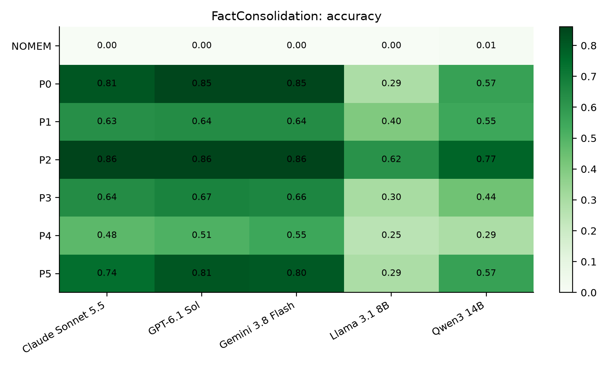

*FactConsolidation: accuracy by policy and model*

*FactConsolidation: staleness rate by policy and model*

### FactConsolidation (clean)

Each cell: accuracy [95% interval] / staleness rate.

| policy | Claude Sonnet 5.5 | GPT-6.1 Sol | Gemini 3.8 Flash | Llama 3.1 8B | Qwen3 14B |
|---|---|---|---|---|---|
| NOMEM | 0.000 [0.00, 0.00] / 0.000 | 0.000 [0.00, 0.00] / 0.000 | 0.000 [0.00, 0.00] / 0.000 | 0.000 [0.00, 0.00] / 0.000 | 0.010 [0.00, 0.03] / 0.030 |
| P0 | 0.808 [0.73, 0.89] / 0.000 | 0.848 [0.78, 0.92] / 0.000 | 0.848 [0.78, 0.92] / 0.000 | 0.293 [0.21, 0.38] / 0.343 | 0.576 [0.47, 0.68] / 0.020 |
| P1 | 0.636 [0.54, 0.73] / 0.020 | 0.646 [0.55, 0.74] / 0.000 | 0.646 [0.55, 0.74] / 0.000 | 0.404 [0.30, 0.51] / 0.141 | 0.556 [0.45, 0.66] / 0.010 |
| P2 | 0.859 [0.79, 0.92] / 0.000 | 0.859 [0.79, 0.92] / 0.000 | 0.859 [0.79, 0.92] / 0.000 | 0.616 [0.52, 0.72] / 0.061 | 0.768 [0.68, 0.85] / 0.000 |
| P3 | 0.636 [0.55, 0.73] / 0.121 | 0.667 [0.58, 0.76] / 0.131 | 0.657 [0.57, 0.75] / 0.121 | 0.303 [0.21, 0.39] / 0.354 | 0.444 [0.34, 0.55] / 0.121 |
| P4 | 0.485 [0.38, 0.59] / 0.263 | 0.515 [0.41, 0.62] / 0.263 | 0.556 [0.45, 0.65] / 0.232 | 0.253 [0.17, 0.34] / 0.455 | 0.293 [0.20, 0.38] / 0.424 |
| P5 | 0.747 [0.66, 0.83] / 0.040 | 0.808 [0.73, 0.88] / 0.030 | 0.808 [0.73, 0.88] / 0.030 | 0.283 [0.20, 0.37] / 0.343 | 0.576 [0.47, 0.68] / 0.040 |

*FactConsolidation (clean): accuracy by policy and model*

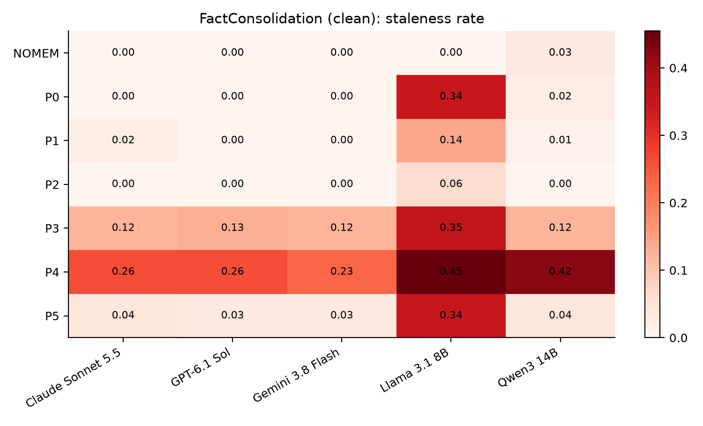

*FactConsolidation (clean): staleness rate by policy and model*

### ConvoMem

Each cell: accuracy [95% interval] / staleness rate.

| policy | Claude Sonnet 5.5 | GPT-6.1 Sol | Gemini 3.8 Flash | Llama 3.1 8B | Qwen3 14B |
|---|---|---|---|---|---|
| NOMEM | 0.000 [0.00, 0.00] / 0.020 | 0.000 [0.00, 0.00] / 0.000 | 0.000 [0.00, 0.00] / 0.000 | 0.000 [0.00, 0.00] / 0.000 | 0.000 [0.00, 0.00] / 0.000 |
| P0 | 0.120 [0.06, 0.19] / 0.190 | 0.120 [0.06, 0.19] / 0.170 | 0.110 [0.05, 0.17] / 0.140 | 0.090 [0.04, 0.15] / 0.110 | 0.110 [0.05, 0.17] / 0.160 |
| P1 | 0.120 [0.06, 0.19] / 0.190 | 0.120 [0.06, 0.19] / 0.170 | 0.110 [0.05, 0.17] / 0.140 | 0.090 [0.04, 0.15] / 0.110 | 0.110 [0.05, 0.17] / 0.160 |
| P2 | 0.070 [0.02, 0.12] / 0.140 | 0.080 [0.03, 0.14] / 0.120 | 0.080 [0.03, 0.13] / 0.110 | 0.050 [0.01, 0.09] / 0.090 | 0.080 [0.03, 0.14] / 0.110 |
| P3 | 0.110 [0.05, 0.17] / 0.190 | 0.120 [0.06, 0.19] / 0.170 | 0.110 [0.05, 0.17] / 0.140 | 0.090 [0.04, 0.15] / 0.120 | 0.110 [0.05, 0.17] / 0.160 |
| P4 | 0.100 [0.05, 0.16] / 0.190 | 0.120 [0.06, 0.19] / 0.160 | 0.110 [0.05, 0.17] / 0.140 | 0.060 [0.02, 0.11] / 0.120 | 0.100 [0.04, 0.16] / 0.140 |
| P5 | 0.080 [0.03, 0.14] / 0.140 | 0.080 [0.03, 0.14] / 0.100 | 0.090 [0.04, 0.15] / 0.080 | 0.040 [0.01, 0.08] / 0.070 | 0.080 [0.03, 0.14] / 0.130 |

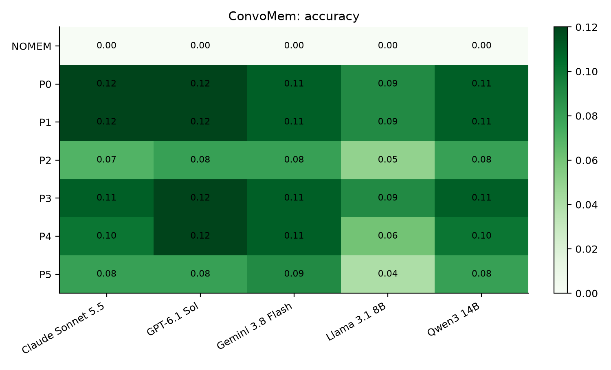

*ConvoMem: accuracy by policy and model*

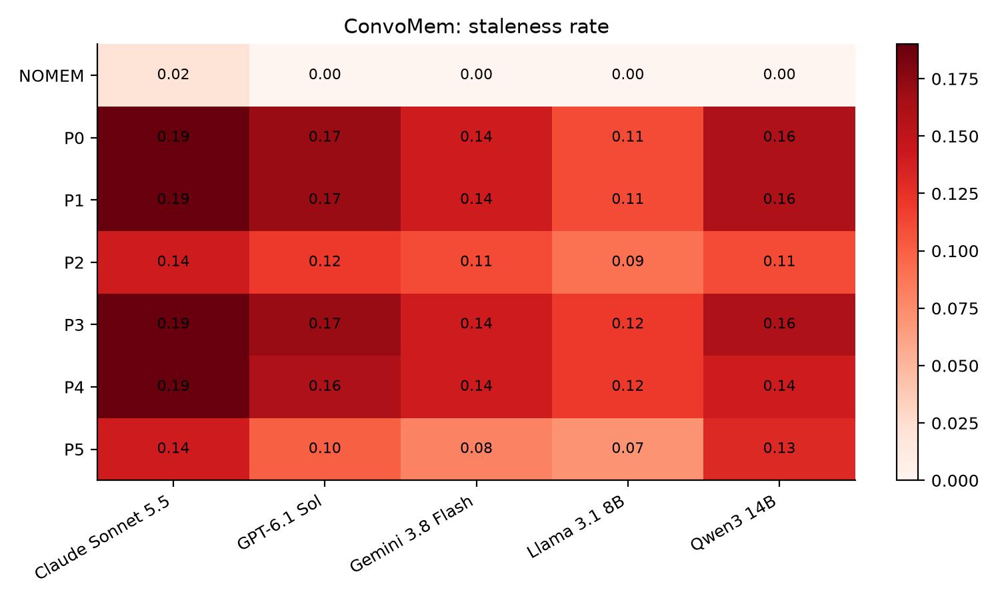

*ConvoMem: staleness rate by policy and model*

## 2. RQ1: does append-only memory surface superseded facts?

| benchmark | model | tier | P0 staleness [95% CI] | old value in prompt, P0 | old value in prompt, P2 | stale answer when the old value was in the prompt |
|---|---|---|---|---|---|---|
| MQuAKE-T | Claude Sonnet 5.5 | frontier | 0.010 [0.000, 0.031] | 1.000 | 0.062 | 0.010 (n=96) |
| MQuAKE-T | GPT-6.1 Sol | frontier | 0.010 [0.000, 0.031] | 1.000 | 0.062 | 0.010 (n=96) |
| MQuAKE-T | Gemini 3.8 Flash | mid | 0.010 [0.000, 0.031] | 1.000 | 0.062 | 0.010 (n=96) |
| MQuAKE-T | Llama 3.1 8B | small | 0.208 [0.135, 0.292] | 1.000 | 0.062 | 0.208 (n=96) |
| MQuAKE-T | Qwen3 14B | small | 0.021 [0.000, 0.052] | 1.000 | 0.062 | 0.021 (n=96) |
| MQuAKE-T (clean) | Claude Sonnet 5.5 | frontier | 0.000 [0.000, 0.000] | 1.000 | 0.056 | 0.000 (n=89) |
| MQuAKE-T (clean) | GPT-6.1 Sol | frontier | 0.000 [0.000, 0.000] | 1.000 | 0.056 | 0.000 (n=89) |
| MQuAKE-T (clean) | Gemini 3.8 Flash | mid | 0.000 [0.000, 0.000] | 1.000 | 0.056 | 0.000 (n=89) |
| MQuAKE-T (clean) | Llama 3.1 8B | small | 0.225 [0.146, 0.315] | 1.000 | 0.056 | 0.225 (n=89) |
| MQuAKE-T (clean) | Qwen3 14B | small | 0.011 [0.000, 0.034] | 1.000 | 0.056 | 0.011 (n=89) |
| FactConsolidation | Claude Sonnet 5.5 | frontier | 0.000 [0.000, 0.000] | 0.954 | 0.569 | 0.000 (n=62) |
| FactConsolidation | GPT-6.1 Sol | frontier | 0.000 [0.000, 0.000] | 0.954 | 0.569 | 0.000 (n=62) |
| FactConsolidation | Gemini 3.8 Flash | mid | 0.000 [0.000, 0.000] | 0.954 | 0.569 | 0.000 (n=62) |
| FactConsolidation | Llama 3.1 8B | small | 0.340 [0.250, 0.430] | 0.954 | 0.569 | 0.548 (n=62) |
| FactConsolidation | Qwen3 14B | small | 0.020 [0.000, 0.050] | 0.954 | 0.569 | 0.032 (n=62) |
| FactConsolidation (clean) | Claude Sonnet 5.5 | frontier | 0.000 [0.000, 0.000] | 0.953 | 0.562 | 0.000 (n=61) |
| FactConsolidation (clean) | GPT-6.1 Sol | frontier | 0.000 [0.000, 0.000] | 0.953 | 0.562 | 0.000 (n=61) |
| FactConsolidation (clean) | Gemini 3.8 Flash | mid | 0.000 [0.000, 0.000] | 0.953 | 0.562 | 0.000 (n=61) |
| FactConsolidation (clean) | Llama 3.1 8B | small | 0.343 [0.253, 0.434] | 0.953 | 0.562 | 0.557 (n=61) |
| FactConsolidation (clean) | Qwen3 14B | small | 0.020 [0.000, 0.051] | 0.953 | 0.562 | 0.033 (n=61) |
| ConvoMem | Claude Sonnet 5.5 | frontier | 0.190 [0.120, 0.270] | 0.340 | 0.270 | 0.529 (n=34) |
| ConvoMem | GPT-6.1 Sol | frontier | 0.170 [0.100, 0.250] | 0.340 | 0.270 | 0.500 (n=34) |
| ConvoMem | Gemini 3.8 Flash | mid | 0.140 [0.080, 0.210] | 0.340 | 0.270 | 0.412 (n=34) |
| ConvoMem | Llama 3.1 8B | small | 0.110 [0.050, 0.170] | 0.340 | 0.270 | 0.324 (n=34) |
| ConvoMem | Qwen3 14B | small | 0.160 [0.090, 0.230] | 0.340 | 0.270 | 0.471 (n=34) |

The last column is the model's reading error: the share of answers that repeat the old value when it was shown next to the new one. Retrieval decides whether the old value is shown; the model decides only how often it falls for it.

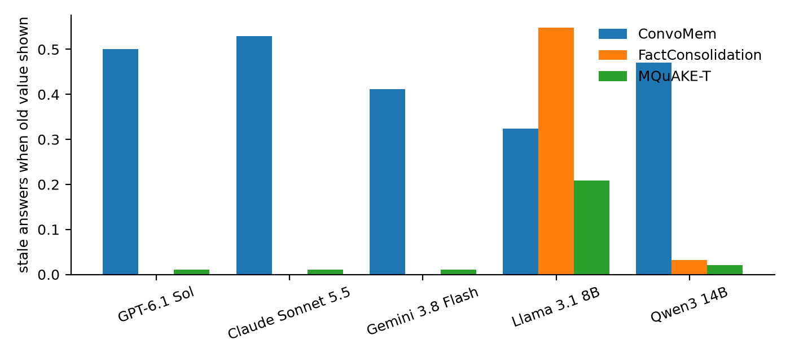

*Reading error by model: how often a model repeats the old value when it is in the prompt (P0)*

## 3. RQ2: which policy gives the best trade-off?

### MQuAKE-T

Averaged over answer models. Tokens are prompt tokens per question; facts are those stored at the end.

| policy | accuracy | staleness | prompt tokens / q | facts stored |
|---|---|---|---|---|
| NOMEM | 0.006 | 0.000 | 98 | 382 |
| P0 | 0.935 | 0.052 | 717 | 382 |
| P1 | 0.846 | 0.035 | 716 | 251 |
| P2 | 0.985 | 0.006 | 577 | 337 |
| P3 | 0.783 | 0.165 | 709 | 351 |
| P4 | 0.915 | 0.067 | 717 | 379 |
| P5 | 0.750 | 0.227 | 716 | 362 |

P2 minus each other policy, per question, pooled over models. Intervals are paired bootstrap; p-values are exact McNemar, Holm-corrected within each column.

| vs | accuracy difference | p (Holm) | staleness difference | p (Holm) |
|---|---|---|---|---|
| P0 | +0.050 [+0.029, +0.071] | <0.001 | -0.046 [-0.067, -0.027] | <0.001 |
| P1 | +0.140 [+0.108, +0.171] | <0.001 | -0.029 [-0.046, -0.015] | <0.001 |
| P3 | +0.202 [+0.165, +0.240] | <0.001 | -0.158 [-0.192, -0.127] | <0.001 |
| P4 | +0.071 [+0.048, +0.096] | <0.001 | -0.060 [-0.083, -0.040] | <0.001 |
| P5 | +0.235 [+0.198, +0.273] | <0.001 | -0.221 [-0.258, -0.183] | <0.001 |

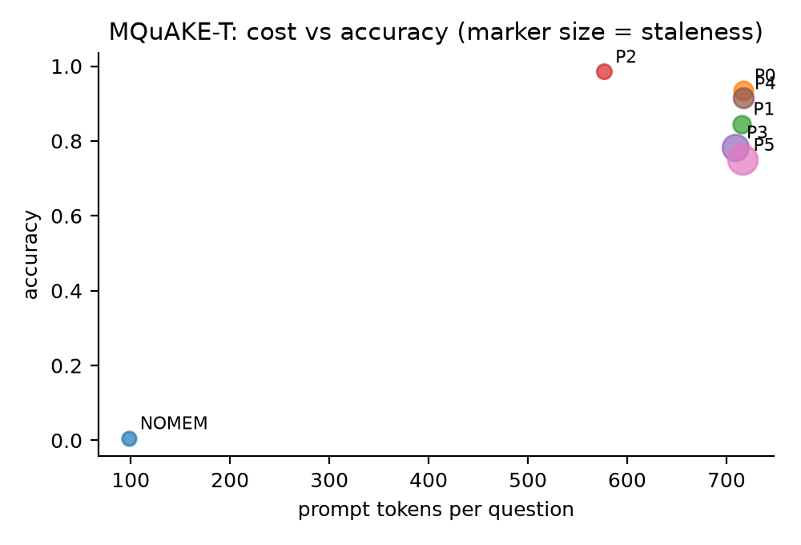

*MQuAKE-T: accuracy against prompt tokens, averaged over models*

### MQuAKE-T (clean)

Averaged over answer models. Tokens are prompt tokens per question; facts are those stored at the end.

| policy | accuracy | staleness | prompt tokens / q | facts stored |
|---|---|---|---|---|
| NOMEM | 0.007 | 0.000 | 98 | 382 |
| P0 | 0.939 | 0.047 | 717 | 382 |
| P1 | 0.847 | 0.027 | 716 | 251 |
| P2 | 0.993 | 0.002 | 579 | 337 |
| P3 | 0.789 | 0.178 | 709 | 351 |
| P4 | 0.917 | 0.065 | 717 | 379 |
| P5 | 0.807 | 0.169 | 716 | 362 |

P2 minus each other policy, per question, pooled over models. Intervals are paired bootstrap; p-values are exact McNemar, Holm-corrected within each column.

| vs | accuracy difference | p (Holm) | staleness difference | p (Holm) |
|---|---|---|---|---|
| P0 | +0.054 [+0.031, +0.079] | <0.001 | -0.045 [-0.065, -0.027] | <0.001 |
| P1 | +0.146 [+0.115, +0.180] | <0.001 | -0.025 [-0.040, -0.011] | <0.001 |
| P3 | +0.204 [+0.166, +0.243] | <0.001 | -0.175 [-0.211, -0.142] | <0.001 |
| P4 | +0.076 [+0.052, +0.103] | <0.001 | -0.063 [-0.088, -0.040] | <0.001 |
| P5 | +0.187 [+0.151, +0.225] | <0.001 | -0.166 [-0.202, -0.133] | <0.001 |

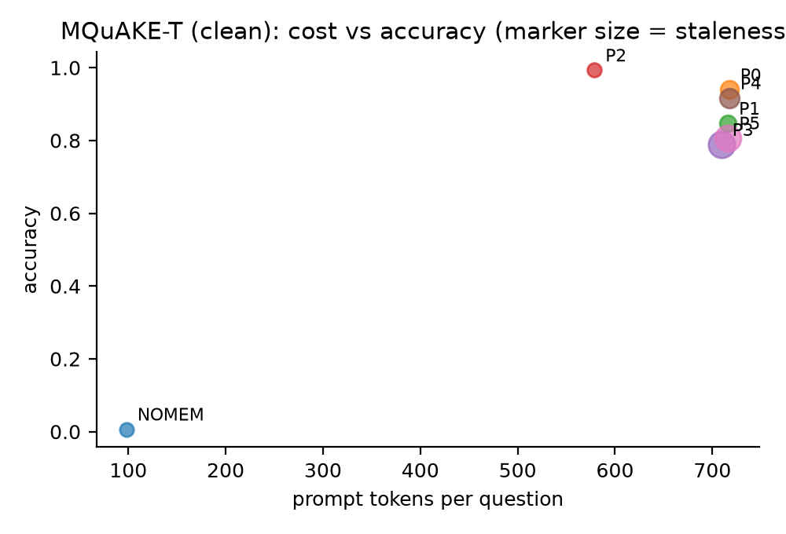

*MQuAKE-T (clean): accuracy against prompt tokens, averaged over models*

### FactConsolidation

Averaged over answer models. Tokens are prompt tokens per question; facts are those stored at the end.

| policy | accuracy | staleness | prompt tokens / q | facts stored |
|---|---|---|---|---|
| NOMEM | 0.002 | 0.006 | 95 | 380 |
| P0 | 0.674 | 0.072 | 661 | 380 |
| P1 | 0.572 | 0.038 | 664 | 210 |
| P2 | 0.794 | 0.012 | 601 | 320 |
| P3 | 0.542 | 0.168 | 663 | 334 |
| P4 | 0.416 | 0.334 | 664 | 302 |
| P5 | 0.642 | 0.102 | 663 | 367 |

P2 minus each other policy, per question, pooled over models. Intervals are paired bootstrap; p-values are exact McNemar, Holm-corrected within each column.

| vs | accuracy difference | p (Holm) | staleness difference | p (Holm) |
|---|---|---|---|---|
| P0 | +0.120 [+0.088, +0.152] | <0.001 | -0.060 [-0.080, -0.040] | <0.001 |
| P1 | +0.222 [+0.180, +0.264] | <0.001 | -0.026 [-0.044, -0.008] | 0.007 |
| P3 | +0.252 [+0.214, +0.292] | <0.001 | -0.156 [-0.188, -0.124] | <0.001 |
| P4 | +0.378 [+0.336, +0.420] | <0.001 | -0.322 [-0.364, -0.282] | <0.001 |
| P5 | +0.152 [+0.120, +0.184] | <0.001 | -0.090 [-0.116, -0.064] | <0.001 |

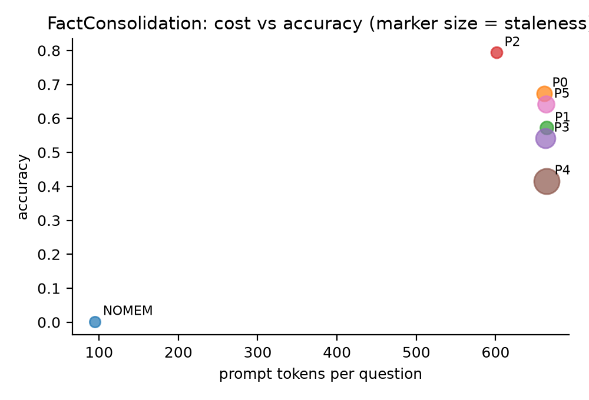

*FactConsolidation: accuracy against prompt tokens, averaged over models*

### FactConsolidation (clean)

Averaged over answer models. Tokens are prompt tokens per question; facts are those stored at the end.

| policy | accuracy | staleness | prompt tokens / q | facts stored |
|---|---|---|---|---|
| NOMEM | 0.002 | 0.006 | 95 | 380 |
| P0 | 0.675 | 0.073 | 660 | 380 |
| P1 | 0.578 | 0.034 | 664 | 210 |
| P2 | 0.792 | 0.012 | 601 | 320 |
| P3 | 0.541 | 0.170 | 662 | 334 |
| P4 | 0.420 | 0.327 | 663 | 302 |
| P5 | 0.644 | 0.097 | 663 | 367 |

P2 minus each other policy, per question, pooled over models. Intervals are paired bootstrap; p-values are exact McNemar, Holm-corrected within each column.

| vs | accuracy difference | p (Holm) | staleness difference | p (Holm) |
|---|---|---|---|---|
| P0 | +0.117 [+0.089, +0.149] | <0.001 | -0.061 [-0.081, -0.040] | <0.001 |
| P1 | +0.214 [+0.174, +0.257] | <0.001 | -0.022 [-0.040, -0.006] | 0.019 |
| P3 | +0.251 [+0.214, +0.291] | <0.001 | -0.158 [-0.190, -0.125] | <0.001 |
| P4 | +0.372 [+0.327, +0.416] | <0.001 | -0.315 [-0.356, -0.275] | <0.001 |
| P5 | +0.147 [+0.115, +0.180] | <0.001 | -0.085 [-0.109, -0.061] | <0.001 |

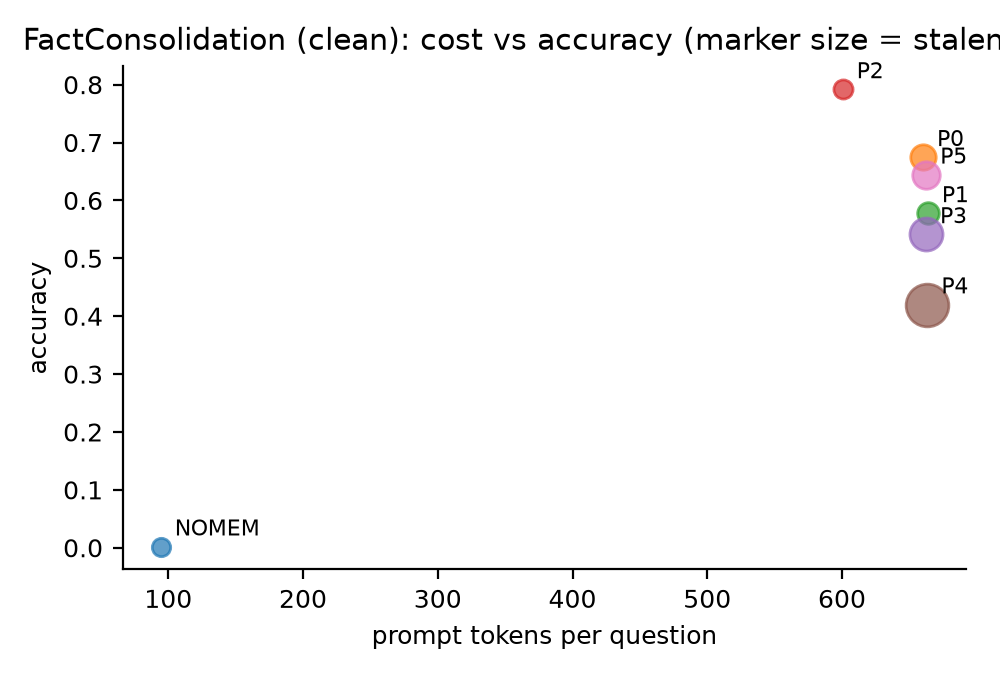

*FactConsolidation (clean): accuracy against prompt tokens, averaged over models*

### ConvoMem

Averaged over answer models. Tokens are prompt tokens per question; facts are those stored at the end.

| policy | accuracy | staleness | prompt tokens / q | facts stored |
|---|---|---|---|---|
| NOMEM | 0.000 | 0.004 | 99 | 603 |
| P0 | 0.110 | 0.154 | 808 | 603 |
| P1 | 0.110 | 0.154 | 808 | 603 |
| P2 | 0.072 | 0.114 | 606 | 452 |
| P3 | 0.108 | 0.156 | 802 | 579 |
| P4 | 0.098 | 0.150 | 781 | 474 |
| P5 | 0.074 | 0.104 | 668 | 253 |

P2 minus each other policy, per question, pooled over models. Intervals are paired bootstrap; p-values are exact McNemar, Holm-corrected within each column.

| vs | accuracy difference | p (Holm) | staleness difference | p (Holm) |
|---|---|---|---|---|
| P0 | -0.038 [-0.058, -0.022] | <0.001 | -0.040 [-0.062, -0.020] | 0.001 |
| P1 | -0.038 [-0.058, -0.022] | <0.001 | -0.040 [-0.062, -0.020] | 0.001 |
| P3 | -0.036 [-0.054, -0.020] | <0.001 | -0.042 [-0.066, -0.022] | <0.001 |
| P4 | -0.026 [-0.042, -0.010] | 0.005 | -0.036 [-0.060, -0.014] | 0.004 |
| P5 | -0.002 [-0.012, +0.008] | 1.000 | +0.010 [-0.008, +0.028] | 0.383 |

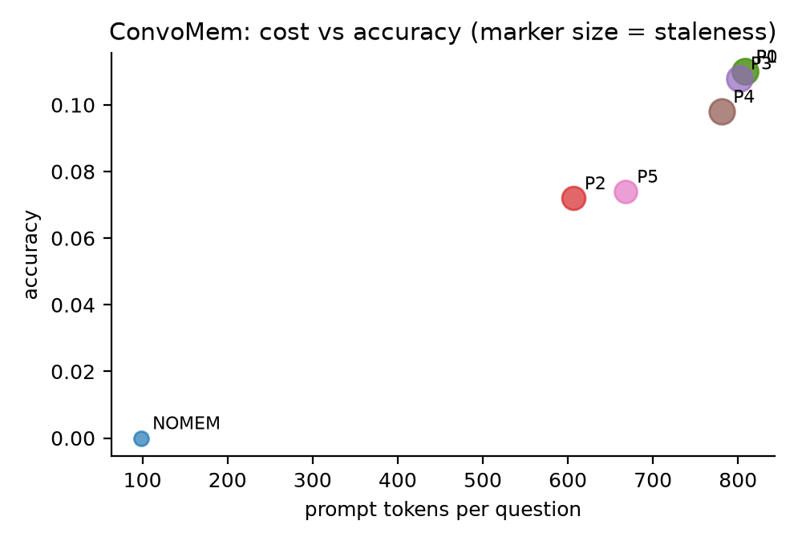

*ConvoMem: accuracy against prompt tokens, averaged over models*

## 4. RQ3: is it the timeline, or any graph-aware clean-up? (P2 vs P5)

| benchmark | model | accuracy P2 - P5 | p (Holm) | staleness P2 - P5 | p (Holm) |
|---|---|---|---|---|---|
| MQuAKE-T | Claude Sonnet 5.5 | +0.198 [+0.125, +0.281] | <0.001 | -0.198 [-0.281, -0.125] | <0.001 |
| MQuAKE-T | GPT-6.1 Sol | +0.208 [+0.135, +0.292] | <0.001 | -0.208 [-0.292, -0.135] | <0.001 |
| MQuAKE-T | Gemini 3.8 Flash | +0.198 [+0.125, +0.281] | <0.001 | -0.198 [-0.281, -0.125] | <0.001 |
| MQuAKE-T | Llama 3.1 8B | +0.354 [+0.260, +0.448] | <0.001 | -0.302 [-0.396, -0.208] | <0.001 |
| MQuAKE-T | Qwen3 14B | +0.219 [+0.135, +0.302] | <0.001 | -0.198 [-0.281, -0.125] | <0.001 |
| MQuAKE-T | all models | +0.235 [+0.198, +0.273] | <0.001 | -0.221 [-0.258, -0.183] | <0.001 |
| MQuAKE-T (clean) | Claude Sonnet 5.5 | +0.146 [+0.079, +0.225] | 0.003 | -0.135 [-0.213, -0.067] | 0.008 |
| MQuAKE-T (clean) | GPT-6.1 Sol | +0.157 [+0.090, +0.236] | 0.002 | -0.157 [-0.236, -0.090] | 0.002 |
| MQuAKE-T (clean) | Gemini 3.8 Flash | +0.146 [+0.079, +0.225] | 0.003 | -0.146 [-0.225, -0.079] | 0.004 |
| MQuAKE-T (clean) | Llama 3.1 8B | +0.315 [+0.213, +0.416] | <0.001 | -0.258 [-0.348, -0.169] | <0.001 |
| MQuAKE-T (clean) | Qwen3 14B | +0.169 [+0.090, +0.247] | 0.001 | -0.135 [-0.213, -0.067] | 0.008 |
| MQuAKE-T (clean) | all models | +0.187 [+0.151, +0.225] | <0.001 | -0.166 [-0.202, -0.133] | <0.001 |
| FactConsolidation | Claude Sonnet 5.5 | +0.120 [+0.060, +0.190] | 0.006 | -0.050 [-0.100, -0.010] | 0.875 |
| FactConsolidation | GPT-6.1 Sol | +0.050 [+0.010, +0.100] | 0.562 | -0.030 [-0.070, +0.000] | 1.000 |
| FactConsolidation | Gemini 3.8 Flash | +0.060 [+0.020, +0.110] | 0.312 | -0.040 [-0.080, -0.010] | 1.000 |
| FactConsolidation | Llama 3.1 8B | +0.330 [+0.230, +0.430] | <0.001 | -0.280 [-0.360, -0.190] | <0.001 |
| FactConsolidation | Qwen3 14B | +0.200 [+0.110, +0.290] | 0.001 | -0.050 [-0.100, -0.010] | 0.875 |
| FactConsolidation | all models | +0.152 [+0.120, +0.184] | <0.001 | -0.090 [-0.116, -0.064] | <0.001 |
| FactConsolidation (clean) | Claude Sonnet 5.5 | +0.111 [+0.051, +0.172] | 0.011 | -0.040 [-0.081, -0.010] | 1.000 |
| FactConsolidation (clean) | GPT-6.1 Sol | +0.051 [+0.010, +0.101] | 0.562 | -0.030 [-0.071, +0.000] | 1.000 |
| FactConsolidation (clean) | Gemini 3.8 Flash | +0.051 [+0.010, +0.101] | 0.562 | -0.030 [-0.071, +0.000] | 1.000 |
| FactConsolidation (clean) | Llama 3.1 8B | +0.333 [+0.232, +0.424] | <0.001 | -0.283 [-0.374, -0.192] | <0.001 |
| FactConsolidation (clean) | Qwen3 14B | +0.192 [+0.101, +0.283] | 0.002 | -0.040 [-0.081, -0.010] | 1.000 |
| FactConsolidation (clean) | all models | +0.147 [+0.115, +0.180] | <0.001 | -0.085 [-0.109, -0.061] | <0.001 |
| ConvoMem | Claude Sonnet 5.5 | -0.010 [-0.030, +0.000] | 1.000 | +0.000 [-0.050, +0.050] | 1.000 |
| ConvoMem | GPT-6.1 Sol | +0.000 [-0.030, +0.030] | 1.000 | +0.020 [+0.000, +0.050] | 1.000 |
| ConvoMem | Gemini 3.8 Flash | -0.010 [-0.030, +0.000] | 1.000 | +0.030 [-0.010, +0.080] | 1.000 |
| ConvoMem | Llama 3.1 8B | +0.010 [-0.020, +0.040] | 1.000 | +0.020 [-0.020, +0.060] | 1.000 |
| ConvoMem | Qwen3 14B | +0.000 [+0.000, +0.000] | 1.000 | -0.020 [-0.060, +0.020] | 1.000 |
| ConvoMem | all models | -0.002 [-0.012, +0.008] | 1.000 | +0.010 [-0.008, +0.028] | 1.000 |

## 5. Small models against frontier models

| benchmark | model | tier | accuracy NOMEM | accuracy P0 | accuracy P2 | P2 accuracy gain | P2 staleness reduction | USD per 1,000 correct answers (P2) |
|---|---|---|---|---|---|---|---|---|
| MQuAKE-T | Claude Sonnet 5.5 | frontier | 0.000 | 0.979 | 0.990 | +0.010 | +0.010 | 1.73 |
| MQuAKE-T | GPT-6.1 Sol | frontier | 0.000 | 0.990 | 0.990 | +0.000 | +0.000 | 1.10 |
| MQuAKE-T | Gemini 3.8 Flash | mid | 0.000 | 0.990 | 0.990 | +0.000 | +0.000 | 0.47 |
| MQuAKE-T | Llama 3.1 8B | small | 0.000 | 0.771 | 0.979 | +0.208 | +0.198 | 0.01 |
| MQuAKE-T | Qwen3 14B | small | 0.031 | 0.948 | 0.979 | +0.031 | +0.021 | 0.12 |
| FactConsolidation | Claude Sonnet 5.5 | frontier | 0.000 | 0.810 | 0.860 | +0.050 | +0.000 | 2.10 |
| FactConsolidation | GPT-6.1 Sol | frontier | 0.000 | 0.850 | 0.860 | +0.010 | +0.000 | 1.28 |
| FactConsolidation | Gemini 3.8 Flash | mid | 0.000 | 0.850 | 0.860 | +0.010 | +0.000 | 0.60 |
| FactConsolidation | Llama 3.1 8B | small | 0.000 | 0.290 | 0.620 | +0.330 | +0.280 | 0.02 |
| FactConsolidation | Qwen3 14B | small | 0.010 | 0.570 | 0.770 | +0.200 | +0.020 | 0.21 |
| ConvoMem | Claude Sonnet 5.5 | frontier | 0.000 | 0.120 | 0.070 | -0.050 | +0.050 | 27.00 |
| ConvoMem | GPT-6.1 Sol | frontier | 0.000 | 0.120 | 0.080 | -0.040 | +0.050 | 14.51 |
| ConvoMem | Gemini 3.8 Flash | mid | 0.000 | 0.110 | 0.080 | -0.030 | +0.030 | 7.68 |
| ConvoMem | Llama 3.1 8B | small | 0.000 | 0.090 | 0.050 | -0.040 | +0.020 | 0.22 |
| ConvoMem | Qwen3 14B | small | 0.000 | 0.110 | 0.080 | -0.030 | +0.050 | 1.63 |

Staleness removed by P2, small models minus frontier models: +0.079 [+0.051, +0.108] (bootstrap over questions). A positive value means forgetting matters more for the small models, which misread conflicting facts more often.

## 6. Do policy rankings agree across models and benchmarks?

Kendall's W over all 15 model and benchmark combinations (accuracy, six policies): **0.28** (1 = every combination ranks the policies identically, 0 = no agreement).

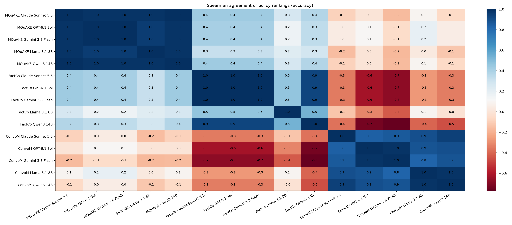

*Pairwise Spearman correlation of policy rankings by accuracy*

Kendall's W over all 15 model and benchmark combinations (staleness, six policies): **0.45** (1 = every combination ranks the policies identically, 0 = no agreement).

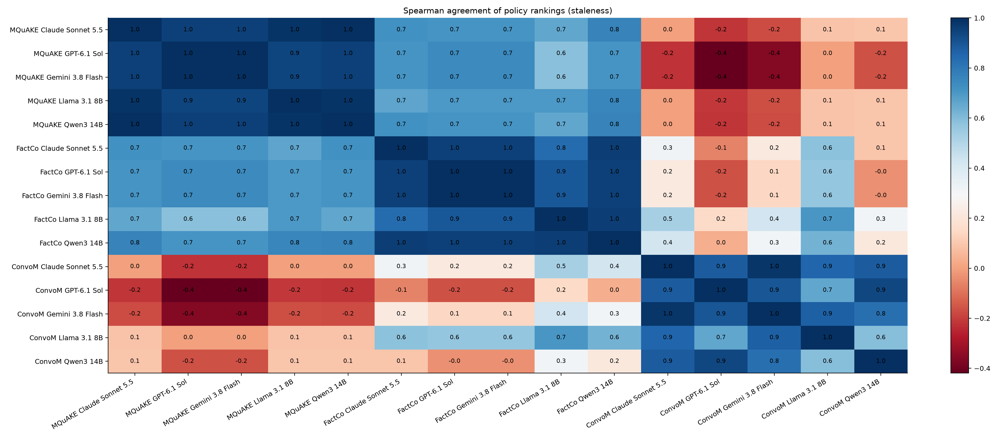

*Pairwise Spearman correlation of policy rankings by staleness*

## 7. How far to trust the judge

| benchmark | graded answers | mean token F1 when judged correct | when judged incorrect | gold answer quoted verbatim but judged incorrect |
|---|---|---|---|---|
| MQuAKE-T | 3360 | 0.683 | 0.017 | 13 of 3360 |
| FactConsolidation | 3500 | 0.637 | 0.015 | 73 of 3465 |
| ConvoMem | 3500 | 0.580 | 0.114 | 1 of 980 |

Judge check: openrouter:deepseek/deepseek-v4.1-flash against openrouter:anthropic/claude-sonnet-5.5 on 198 existing answers: agreement 0.960, Cohen's kappa 0.919; the cheap judge said correct where the reference said incorrect 4 times, and the reverse 4 times.

## 8. How contradictions are detected: exact, normalised, language model

P2 under the three relation-matching modes. Exact compares relation names as written; normalised compares cleaned names and also matches facts written in the opposite direction; the language model mode asks a fixed model which stored facts a new fact replaces, as Zep does.

| benchmark | matching | model | accuracy | staleness | facts closed | language model checks |
|---|---|---|---|---|---|---|
| MQuAKE-T | exact | Llama 3.1 8B | 0.979 | 0.010 | 95 | 0 |
| MQuAKE-T | exact | Qwen3 14B | 0.979 | 0.000 | 95 | 0 |
| MQuAKE-T | normalized | Llama 3.1 8B | 0.979 | 0.010 | 95 | 0 |
| MQuAKE-T | normalized | Qwen3 14B | 0.979 | 0.000 | 95 | 0 |
| MQuAKE-T | llm | Llama 3.1 8B | 0.990 | 0.000 | 96 | 229 |
| MQuAKE-T | llm | Qwen3 14B | 0.979 | 0.000 | 96 | 229 |
| FactConsolidation | exact | Llama 3.1 8B | 0.600 | 0.070 | 102 | 0 |
| FactConsolidation | exact | Qwen3 14B | 0.760 | 0.000 | 102 | 0 |
| FactConsolidation | normalized | Llama 3.1 8B | 0.620 | 0.060 | 103 | 0 |
| FactConsolidation | normalized | Qwen3 14B | 0.770 | 0.000 | 103 | 0 |
| FactConsolidation | llm | Llama 3.1 8B | 0.690 | 0.000 | 132 | 245 |
| FactConsolidation | llm | Qwen3 14B | 0.850 | 0.000 | 132 | 245 |
| ConvoMem | exact | Llama 3.1 8B | 0.060 | 0.060 | 288 | 0 |
| ConvoMem | exact | Qwen3 14B | 0.080 | 0.100 | 288 | 0 |
| ConvoMem | normalized | Llama 3.1 8B | 0.050 | 0.090 | 281 | 0 |
| ConvoMem | normalized | Qwen3 14B | 0.080 | 0.110 | 281 | 0 |
| ConvoMem | llm | Llama 3.1 8B | 0.050 | 0.060 | 196 | 558 |
| ConvoMem | llm | Qwen3 14B | 0.060 | 0.100 | 196 | 558 |

## 9. RQ4: several agents sharing one memory

| matching | topology | policy | accuracy | staleness | tokens / q | contradictions closed | closed by a different writer |
|---|---|---|---|---|---|---|---|
| normalized | independent | NOMEM | 0.000 | 0.000 | 114 | n/a | n/a |
| normalized | independent | P0 | 0.731 | 0.210 | 760 | n/a | n/a |
| normalized | independent | P1 | 0.648 | 0.115 | 755 | n/a | n/a |
| normalized | independent | P2 | 0.733 | 0.210 | 629 | n/a | n/a |
| normalized | independent | P3 | 0.635 | 0.269 | 755 | n/a | n/a |
| normalized | independent | P4 | 0.723 | 0.219 | 760 | n/a | n/a |
| normalized | independent | P5 | 0.640 | 0.302 | 756 | n/a | n/a |
| normalized | orchestrator | NOMEM | 0.000 | 0.000 | 114 | n/a | n/a |
| normalized | orchestrator | P0 | 0.990 | 0.010 | 769 | n/a | n/a |
| normalized | orchestrator | P1 | 0.885 | 0.010 | 751 | n/a | n/a |
| normalized | orchestrator | P2 | 0.990 | 0.010 | 591 | n/a | n/a |
| normalized | orchestrator | P3 | 0.802 | 0.146 | 761 | n/a | n/a |
| normalized | orchestrator | P4 | 0.958 | 0.031 | 773 | n/a | n/a |
| normalized | orchestrator | P5 | 0.812 | 0.188 | 758 | n/a | n/a |
| exact | shared | NOMEM | 0.000 | 0.000 | 114 | 40 | 28 |
| exact | shared | P0 | 0.865 | 0.135 | 759 | 40 | 28 |
| exact | shared | P1 | 0.802 | 0.042 | 744 | 35 | 23 |
| exact | shared | P2 | 0.865 | 0.115 | 693 | 40 | 28 |
| exact | shared | P3 | 0.698 | 0.229 | 778 | 29 | 22 |
| exact | shared | P4 | 0.844 | 0.156 | 757 | 40 | 28 |
| exact | shared | P5 | 0.760 | 0.240 | 755 | 40 | 28 |
| llm | shared | NOMEM | 0.000 | 0.000 | 114 | 74 | 60 |
| llm | shared | P0 | 0.865 | 0.135 | 759 | 74 | 60 |
| llm | shared | P1 | 0.802 | 0.042 | 744 | 62 | 48 |
| llm | shared | P2 | 0.865 | 0.094 | 636 | 74 | 60 |
| llm | shared | P3 | 0.698 | 0.229 | 778 | 53 | 44 |
| llm | shared | P4 | 0.854 | 0.146 | 757 | 74 | 60 |
| llm | shared | P5 | 0.781 | 0.219 | 750 | 74 | 60 |
| normalized | shared | NOMEM | 0.000 | 0.000 | 114 | 60 | 46 |
| normalized | shared | P0 | 0.865 | 0.135 | 759 | 60 | 46 |
| normalized | shared | P1 | 0.802 | 0.042 | 744 | 50 | 36 |
| normalized | shared | P2 | 0.865 | 0.125 | 661 | 60 | 46 |
| normalized | shared | P3 | 0.698 | 0.229 | 778 | 45 | 36 |
| normalized | shared | P4 | 0.854 | 0.146 | 757 | 60 | 46 |
| normalized | shared | P5 | 0.760 | 0.229 | 763 | 60 | 46 |

Does the single-agent ranking (MQuAKE-T, averaged over models) hold in each topology? Spearman correlation of policy accuracies:

| topology | policies compared | Spearman with single agent |
|---|---|---|
| independent | 6 | 0.94 |
| orchestrator | 6 | 0.93 |
| shared | 6 | 0.93 |

## 10. The grace period, with questions about the past

For each question with a superseded answer, two probes: the original question (current answer) and 'Before it was last changed, what was the answer to ...' (superseded answer), answered from retrieval that keeps closed-but-unpruned facts and labels them as superseded. Grace is how many days P2 keeps a closed fact before deleting it.

### ConvoMem

Closed facts at question time: 14; days since closing: median 9.0, max 18.0.

| grace (days) | facts stored | wasted slots | old value still stored | old value retrieved for history probe | Llama 3.1 8B current acc. | Llama 3.1 8B history acc. | Qwen3 14B current acc. | Qwen3 14B history acc. |
|---|---|---|---|---|---|---|---|---|
| 0 | 337 | 1.20 | 0.290 | 0.290 | 0.060 | 0.120 | 0.070 | 0.120 |
| 1 | 367 | 3.01 | 0.300 | 0.300 | 0.050 | 0.110 | 0.070 | 0.130 |
| 3 | 394 | 4.53 | 0.300 | 0.300 | 0.040 | 0.110 | 0.070 | 0.120 |
| 5 | 414 | 5.34 | 0.320 | 0.300 | 0.050 | 0.100 | 0.080 | 0.140 |
| 7 | 452 | 6.82 | 0.320 | 0.290 | 0.050 | 0.110 | 0.080 | 0.140 |
| 10 | 516 | 8.11 | 0.340 | 0.310 | 0.070 | 0.140 | 0.070 | 0.150 |
| 14 | 566 | 8.99 | 0.340 | 0.310 | 0.060 | 0.150 | 0.080 | 0.160 |
| 21 | 603 | 9.37 | 0.380 | 0.340 | 0.060 | 0.160 | 0.070 | 0.160 |
| never | 603 | 9.37 | 0.380 | 0.340 | 0.060 | 0.160 | 0.070 | 0.160 |

### FactConsolidation

Closed facts at question time: 60; days since closing: median 4.0, max 27.0.

| grace (days) | facts stored | wasted slots | old value still stored | old value retrieved for history probe | Llama 3.1 8B current acc. | Llama 3.1 8B history acc. | Qwen3 14B current acc. | Qwen3 14B history acc. |
|---|---|---|---|---|---|---|---|---|
| 0 | 284 | 0.31 | 0.754 | 0.631 | 0.708 | 0.169 | 0.892 | 0.200 |
| 1 | 291 | 0.97 | 0.769 | 0.646 | 0.738 | 0.200 | 0.877 | 0.246 |
| 3 | 302 | 1.65 | 0.785 | 0.662 | 0.692 | 0.246 | 0.846 | 0.308 |
| 5 | 315 | 2.77 | 0.815 | 0.738 | 0.692 | 0.323 | 0.862 | 0.400 |
| 7 | 320 | 2.91 | 0.831 | 0.754 | 0.708 | 0.354 | 0.846 | 0.415 |
| 10 | 335 | 3.83 | 0.908 | 0.831 | 0.769 | 0.354 | 0.862 | 0.477 |
| 14 | 344 | 4.25 | 0.938 | 0.877 | 0.723 | 0.400 | 0.846 | 0.538 |
| 21 | 365 | 4.78 | 0.985 | 0.938 | 0.662 | 0.508 | 0.877 | 0.708 |
| never | 380 | 5.28 | 1.000 | 0.954 | 0.662 | 0.615 | 0.908 | 0.785 |

### MQuAKE-T

Closed facts at question time: 95; days since closing: median 5.0, max 30.0.

| grace (days) | facts stored | wasted slots | old value still stored | old value retrieved for history probe | Llama 3.1 8B current acc. | Llama 3.1 8B history acc. | Qwen3 14B current acc. | Qwen3 14B history acc. |
|---|---|---|---|---|---|---|---|---|
| 0 | 296 | 2.39 | 0.219 | 0.219 | 0.969 | 0.156 | 0.979 | 0.125 |
| 1 | 308 | 3.76 | 0.354 | 0.354 | 0.969 | 0.250 | 0.969 | 0.250 |
| 3 | 320 | 4.86 | 0.469 | 0.469 | 0.969 | 0.354 | 0.979 | 0.375 |
| 5 | 332 | 5.56 | 0.562 | 0.552 | 0.979 | 0.521 | 0.979 | 0.479 |
| 7 | 337 | 5.79 | 0.615 | 0.604 | 0.979 | 0.573 | 0.979 | 0.531 |
| 10 | 347 | 6.24 | 0.719 | 0.708 | 0.969 | 0.677 | 0.979 | 0.625 |
| 14 | 355 | 6.76 | 0.781 | 0.781 | 0.969 | 0.719 | 0.979 | 0.708 |
| 21 | 373 | 7.25 | 0.938 | 0.938 | 0.969 | 0.917 | 0.969 | 0.906 |
| never | 382 | 7.44 | 1.000 | 1.000 | 0.969 | 1.000 | 0.969 | 0.990 |

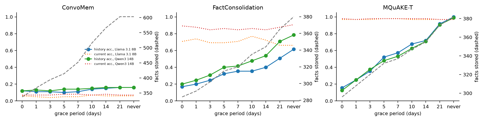

*Grace period: accuracy on current and history questions, and facts stored*

## 11. Retrieval weights on a benchmark the search never saw

FactConsolidation played no part in the weight search. P2, the two small models; each candidate compared with the published weighting on the same questions (exact McNemar).

| model | weighting | accuracy | staleness | better / worse than published | McNemar p |
|---|---|---|---|---|---|
| Llama 3.1 8B | 0.6/0.3/0.1 (published) | 0.620 | 0.060 | - | - |
| Llama 3.1 8B | 0.9/0.1/0.2 (MQuAKE-T best) | 0.620 | 0.050 | 5 / 5 | 1.000 |
| Llama 3.1 8B | 0.8/0.1/0.1 (ConvoMem best) | 0.560 | 0.050 | 5 / 11 | 0.210 |
| Qwen3 14B | 0.6/0.3/0.1 (published) | 0.770 | 0.000 | - | - |
| Qwen3 14B | 0.9/0.1/0.2 (MQuAKE-T best) | 0.810 | 0.000 | 7 / 3 | 0.344 |
| Qwen3 14B | 0.8/0.1/0.1 (ConvoMem best) | 0.780 | 0.000 | 3 / 2 | 1.000 |

## 12. Diagnostics: where the remaining errors come from

Is the answer in memory at all? Share of questions with a superseded answer whose current value, and whose old value, appear anywhere in the stored facts (P0, so nothing is deleted). This is a ceiling no forgetting policy can raise: it is set by extraction.

| benchmark | questions | current value stored | old value stored |
|---|---|---|---|
| MQuAKE-T | 96 | 1.00 | 1.00 |
| FactConsolidation | 65 | 1.00 | 1.00 |
| ConvoMem | 100 | 0.30 | 0.38 |

Grading rules applied on top of the judge: refusals that do not contain the gold answer are incorrect, and a short gold answer stated plainly, without the old value or a negation, is correct. Number of verdicts each rule changed:

| benchmark | graded answers | judge said correct, rule says refusal | judge said incorrect, rule says gold stated |
|---|---|---|---|
| MQuAKE-T | 3360 | 0 | 0 |
| FactConsolidation | 3500 | 0 | 20 |
| ConvoMem | 3500 | 0 | 0 |

Mentioning the old value is not the same as answering with it. Under P0, share of answers that mention the superseded value at all, against the share that give it as the answer:

| benchmark | model | mentions old value | stale (asserts old value) |
|---|---|---|---|
| MQuAKE-T | Claude Sonnet 5.5 | 0.781 | 0.010 |
| MQuAKE-T | GPT-6.1 Sol | 0.010 | 0.010 |
| MQuAKE-T | Gemini 3.8 Flash | 0.021 | 0.010 |
| MQuAKE-T | Llama 3.1 8B | 0.229 | 0.208 |
| MQuAKE-T | Qwen3 14B | 0.031 | 0.021 |
| FactConsolidation | Claude Sonnet 5.5 | 0.510 | 0.000 |
| FactConsolidation | GPT-6.1 Sol | 0.010 | 0.000 |
| FactConsolidation | Gemini 3.8 Flash | 0.130 | 0.000 |
| FactConsolidation | Llama 3.1 8B | 0.380 | 0.340 |
| FactConsolidation | Qwen3 14B | 0.150 | 0.020 |
| ConvoMem | Claude Sonnet 5.5 | 0.230 | 0.190 |
| ConvoMem | GPT-6.1 Sol | 0.170 | 0.170 |
| ConvoMem | Gemini 3.8 Flash | 0.140 | 0.140 |
| ConvoMem | Llama 3.1 8B | 0.110 | 0.110 |
| ConvoMem | Qwen3 14B | 0.170 | 0.160 |

What does language-model consolidation (P4) delete? Facts pruned by P4, and how many of them carry a question's current answer or its superseded answer. On FactConsolidation the current answers are counterfactual, so a model that consolidates with its own world knowledge deletes them and keeps the true-world old value.

| benchmark | facts | pruned by P4 | pruned facts holding a current answer | pruned facts holding an old answer |
|---|---|---|---|---|
| MQuAKE-T | 382 | 3 | 2 | 1 |
| FactConsolidation | 380 | 65 | 49 | 10 |
| ConvoMem | 603 | 120 | 8 | 8 |

## 13. Findings in one place

Generated from the numbers above. Each line is a measured result, not an interpretation; read it with its interval and its table.

* MQuAKE-T: P2 vs P0 accuracy +0.050 [+0.029, +0.071] (P2 significantly more accurate); staleness -0.046 [-0.067, -0.027].
* MQuAKE-T: P3 (novelty gate) vs P2 staleness +0.158, p <0.001.
* MQuAKE-T (clean): P2 vs P0 accuracy +0.054 [+0.031, +0.079] (P2 significantly more accurate); staleness -0.045 [-0.065, -0.027].
* MQuAKE-T (clean): P3 (novelty gate) vs P2 staleness +0.175, p <0.001.
* FactConsolidation: P2 vs P0 accuracy +0.120 [+0.088, +0.152] (P2 significantly more accurate); staleness -0.060 [-0.080, -0.040].
* FactConsolidation: P3 (novelty gate) vs P2 staleness +0.156, p <0.001.
* FactConsolidation (clean): P2 vs P0 accuracy +0.117 [+0.089, +0.149] (P2 significantly more accurate); staleness -0.061 [-0.081, -0.040].
* FactConsolidation (clean): P3 (novelty gate) vs P2 staleness +0.158, p <0.001.
* ConvoMem: P2 vs P0 accuracy -0.038 [-0.058, -0.022] (P2 significantly less accurate); staleness -0.040 [-0.062, -0.020].
* ConvoMem: P3 (novelty gate) vs P2 staleness +0.042, p <0.001.
* MQuAKE-T: P2 vs P5 accuracy +0.235 [+0.198, +0.273], p <0.001.
* FactConsolidation: P2 vs P5 accuracy +0.152 [+0.120, +0.184], p <0.001.
* ConvoMem: P2 vs P5 accuracy -0.002 [-0.012, +0.008], p 1.000.
* P2 removes +0.079 [+0.051, +0.108] more staleness for small models than for frontier models.
* Policy rankings by accuracy agree across models and benchmarks with Kendall's W = 0.28.
* Policy rankings by staleness agree across models and benchmarks with Kendall's W = 0.45.
* The fixed judge agrees with the reference judge on 96.0% of answers (kappa 0.92).

