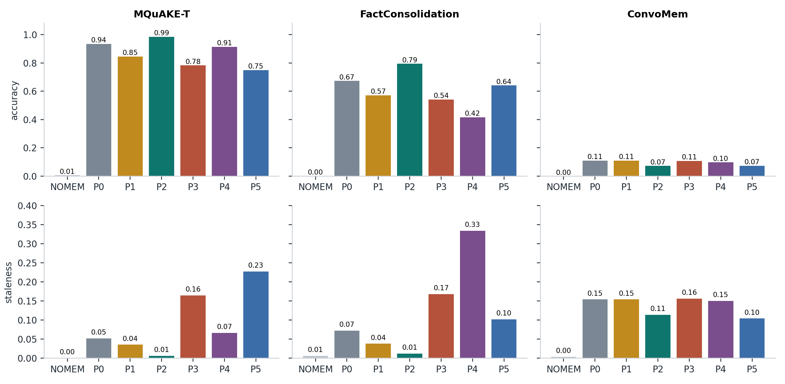
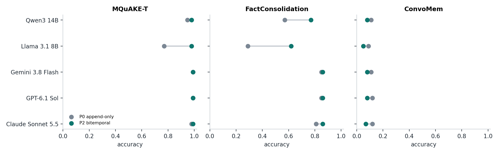
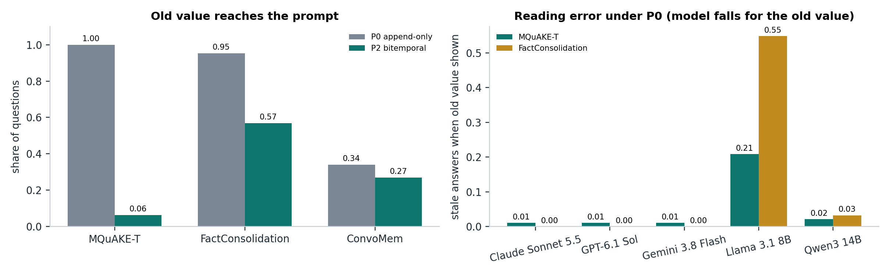
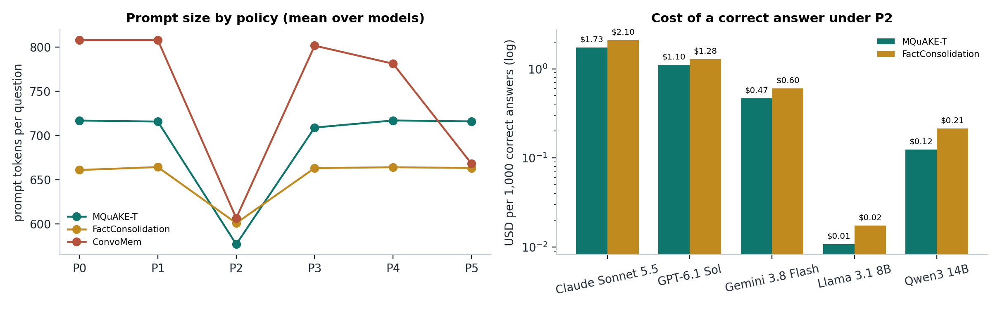
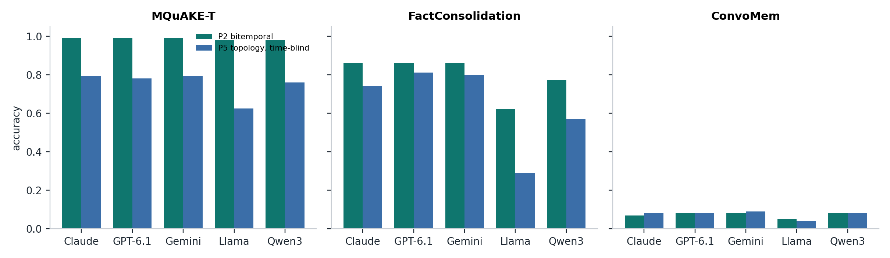
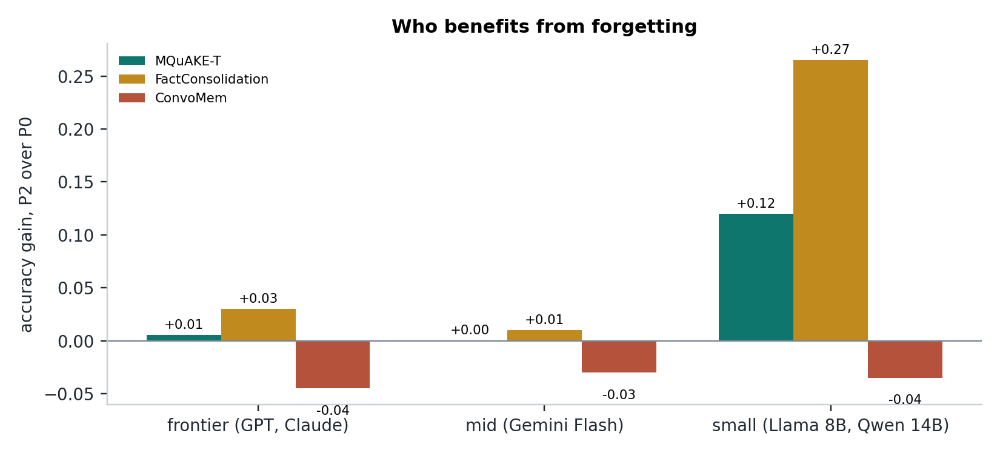
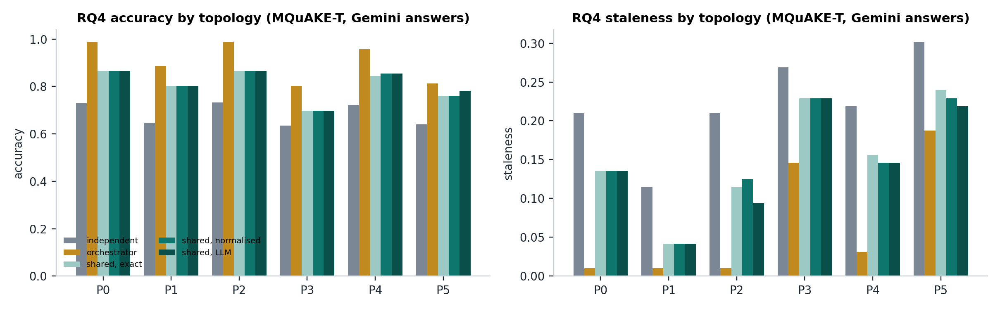
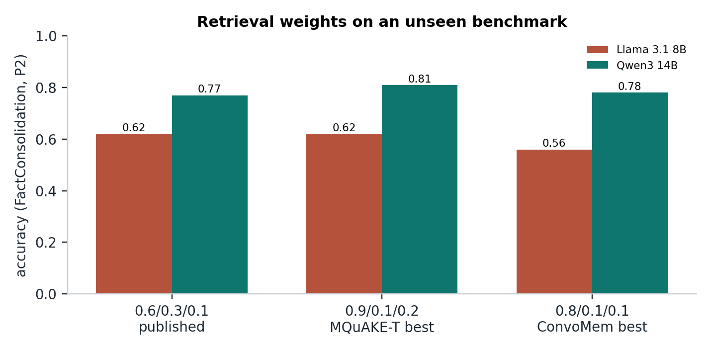

# DRIFT: Decay Rates in Forgetful Bitemporal Memory

## Final campaign report: a controlled study of forgetting policies in LLM agent memory

Nandan Hemanth, Stevens Institute of Technology. Advisor: Dr. Hao Wang. Reader: Dr. Joseph Helsing.
Final campaign run 12 to 13 October 2026; report compiled 22 October 2026.

Companion files: [`FINAL_RESULTS_DASHBOARD.html`](FINAL_RESULTS_DASHBOARD.html) (interactive, every table and figure), [`figures_final/`](figures_final/), [`tables_final/`](tables_final/), [`FINAL_ANALYSIS.md`](FINAL_ANALYSIS.md) (generated statistics), [`PRE_RUN_AUDIT.md`](PRE_RUN_AUDIT.md) (every check and fix before and after the run), raw numbers in [`../artifacts/final_results.json`](../artifacts/final_results.json).

---

## Contents

1. [Summary](#1-summary)
2. [What was run](#2-what-was-run)
3. [What was checked and fixed before the numbers were trusted](#3-what-was-checked-and-fixed-before-the-numbers-were-trusted)
4. [Headline results](#4-headline-results)
5. [RQ1: append-only memory surfaces superseded facts](#5-rq1-append-only-memory-surfaces-superseded-facts)
6. [RQ2: which policy gives the best trade-off](#6-rq2-which-policy-gives-the-best-trade-off)
7. [RQ3: the timeline, not the graph, is what helps](#7-rq3-the-timeline-not-the-graph-is-what-helps)
8. [Small models against frontier models (checkpoint 3)](#8-small-models-against-frontier-models-checkpoint-3)
9. [RQ4: several agents sharing one memory](#9-rq4-several-agents-sharing-one-memory)
10. [The grace period (checkpoint 1)](#10-the-grace-period-checkpoint-1)
11. [The retrieval weights (checkpoint 2)](#11-the-retrieval-weights-checkpoint-2)
12. [How contradictions are detected, and how DRIFT relates to Zep](#12-how-contradictions-are-detected-and-how-drift-relates-to-zep)
13. [Where the remaining errors come from](#13-where-the-remaining-errors-come-from)
14. [Cost and tokens](#14-cost-and-tokens)
15. [Verdict on the hypothesis](#15-verdict-on-the-hypothesis)
16. [Novelty](#16-novelty)
17. [What this means for agent memory](#17-what-this-means-for-agent-memory)
18. [Threats to validity](#18-threats-to-validity)
19. [Limitations and future work](#19-limitations-and-future-work)
20. [Conclusion](#20-conclusion)
21. [References](#21-references)
22. [Appendix A: every cell](#appendix-a-every-cell)
23. [Appendix B: figure and artifact index](#appendix-b-figure-and-artifact-index)

---

## 1. Summary

DRIFT holds an agent's memory system fixed and changes only the forgetting policy: the rule that decides which stored facts are hidden or deleted. The final campaign ran seven policies against five answer models (two frontier, one mid-tier, two small) on three benchmarks that record the superseded answer, then ran four follow-up studies: several agents sharing one memory (RQ4), the grace period with questions about the past, a matching ablation, and a held-out test of the retrieval weights. 10,360 answers were graded in the main matrix alone.

The central result is stronger than the one the thesis set out to show. The hypothesis asked that bitemporal contradiction invalidation (P2) be at least as accurate as append-only memory (P0). On both fact benchmarks it is significantly more accurate:

* MQuAKE-T: accuracy 0.935 to 0.985 (+0.050, 95% CI [+0.029, +0.071], p < 0.001); staleness 0.052 to 0.006.
* FactConsolidation: accuracy 0.674 to 0.794 (+0.120, [+0.088, +0.152], p < 0.001); staleness 0.072 to 0.012.
* P2 sends 9 to 25 percent fewer prompt tokens and stores 12 to 25 percent fewer facts.

The gain is concentrated where it matters most in practice. Frontier models almost never fall for a superseded fact when both old and new are in the prompt; small models do. Llama 3.1 8B rises from 0.771 to 0.979 on MQuAKE-T and from 0.29 to 0.62 on FactConsolidation under P2. P2 makes an 8-billion-parameter model as reliable as a frontier model on knowledge updates at roughly one hundredth of the cost per correct answer.

P2 beats a graph-aware but time-blind policy (P5) by 15 to 24 points, so the benefit comes from the timeline. Novelty gating (P3) and LLM consolidation (P4), both used in deployed systems, make memory worse: the first rejects corrections as duplicates, the second deletes facts that disagree with the consolidating model's own beliefs.

ConvoMem, natural dialogue, is the honest negative result. All policies score near 0.1 because extraction stored the current value for only 30 of 100 questions, and P2 loses 3.8 points because rule-based contradiction detection fires falsely on conversational relations. In dialogue, the bottleneck is what gets written to memory, not what gets forgotten.

---

## 2. What was run

### 2.1 Design

Everything except the forgetting policy is held fixed: the bitemporal store, extraction, retrieval (score = 0.6 cosine + 0.3 lexical + 0.1 recency, top 25), the answer prompt, and the judge. Each fact keeps the date it became true, the date it was stored, and the date its validity closed; a contradiction closes the old fact but deletes nothing, and only the policy hides or deletes.

| Role | Model | Provider (pinned, no fallback) |
|---|---|---|
| Answer, frontier | GPT-6.1 Sol (low reasoning effort) | OpenAI |
| Answer, frontier | Claude Sonnet 5.5 | Anthropic |
| Answer, mid | Gemini 3.8 Flash (low reasoning effort) | Google AI Studio |
| Answer, small | Llama 3.1 8B Instruct | DeepInfra |
| Answer, small, reasoning | Qwen3 14B (thinking on; replaces Qwen3 8B, which OpenRouter stopped serving) | DeepInfra |
| Extraction, judge, P4 review, LLM contradiction check | DeepSeek V4.1 Flash (reasoning off) | DeepInfra |
| Embeddings | nomic-embed-text [19] | local (Ollama) |

| Policy | What it does |
|---|---|
| NOMEM | no memory: the floor |
| P0 | append-only: keep and show everything |
| P1 | time-based decay: delete facts older than 20 days |
| P2 | bitemporal invalidation: hide closed facts at retrieval, delete them 7 days after closing |
| P3 | novelty gate: refuse a fact more than 0.9 similar to a stored one [6] |
| P4 | LLM consolidation: every third session a model decides what to keep [5] |
| P5 | topology consolidation: between conflicting facts keep the better-corroborated one; ignores dates |

| Benchmark | Questions | With a superseded answer | Nature of the changes |
|---|---|---|---|
| MQuAKE-T [13] | 96 | 96 | real Wikidata changes, 2021 to 2023 |
| FactConsolidation [12] | 100 | 65 | deliberately counterfactual, so the model cannot answer from its own knowledge |
| ConvoMem [18] | 100 | 100 | changes stated inside natural user-assistant dialogue |

LoCoMo [10] and LongMemEval [11] were audited and record no superseded answer, so a staleness metric reads zero on them by construction; they are not used.

### 2.2 Metrics and statistics

Terms in one line each, so the rest of the report reads on its own:

* **Superseded fact**: a stored fact that a later fact replaced with a different value for the same subject and relation ("reports to Ashley", once "reports to Daniel" arrives).
* **Bitemporal**: each fact keeps two timelines, when it was true in the world and when the system learned it, which is how DRIFT knows a fact has been replaced without deleting it [15, 16, 17].
* **Retrieval score**: 0.6 x cosine similarity (meaning) + 0.3 x lexical overlap (shared words) + 0.1 x recency (how late the fact's date is); the 25 highest-scoring facts go into the prompt (k = 25).
* **Grace period**: how many days P2 keeps a replaced fact before deleting it; until then it is hidden from answers but still available for questions about the past.
* **Clean subset**: MQuAKE-T without the 7 questions where the dataset itself restates the old value as current, so that a data error is not counted as a memory error.

* **Accuracy**: share of answers graded correct by the judge plus two fixed rules (a refusal without the gold is incorrect; a short gold answer stated plainly, without the old value or a negation, is correct).
* **Staleness**: share of answers that assert the superseded value, meaning the old value appears and the current value does not. Mentioning the old value while giving the new one ("Meloni, who replaced Conte") is counted separately as *mentions old*.
* **Cost**: prompt and completion tokens per question, USD at list price, facts stored.
* **Mechanism**: whether the old value reached the prompt; how often a model repeats it when it did (*reading error*).
* **Statistics.** Every policy answers the same questions, so comparisons are paired, question by question:
  * **Bootstrap 95% interval** [22]: resample the questions 5,000 times and keep the middle 95% of the results; used because accuracy over 100 yes/no answers has no convenient formula for its uncertainty.
  * **Exact McNemar test** [20]: compares two policies using only the questions where they disagree (one right, one wrong); it is the standard test for paired yes/no outcomes, which is exactly what two policies on the same questions produce.
  * **Holm correction** [21]: when many comparisons are made, each p-value is adjusted so that the chance of any false "significant" result stays at 5%; DRIFT compares P2 with five policies on three benchmarks, so without it some differences would look significant by luck.
  * **Spearman correlation** [25]: how similarly two lists rank the same items (1 = identical order); used to ask whether the policy order found with one agent is the same with several.
  * **Kendall's W** [26]: the same idea for many rankings at once (1 = all agree); used to ask whether every model and benchmark ranks the policies the same way.
  * **Cohen's kappa** [23]: agreement between two graders after removing the agreement they would reach by chance (0 = chance, 1 = perfect); used to check that the cheap judge grades like a frontier model.

---

## 3. What was checked and fixed before the numbers were trusted

The full record is in [`PRE_RUN_AUDIT.md`](PRE_RUN_AUDIT.md). Each item below changed what the run would have reported.

| Problem found | Effect if left | Fix |
|---|---|---|
| Facts stored in the opposite direction ("Ardern \| head_of_government_of \| New Zealand", later "New Zealand \| head_of_government \| Hipkins") were never matched | 28 of 96 MQuAKE-T supersessions invisible to P2 under the old extractors | direction-insensitive matching in normalised mode; with one consistent extractor, 95 of 96 detected |
| Reasoning models ran out of extraction budget and returned unfinished thoughts | 64 of 200 ConvoMem sessions and 20 of 38 RQ4 pilot sessions silently stored no facts | retry with 4,096 tokens on an unparseable reply |
| Only the last of ten ConvoMem graphs was saved | mechanism analysis impossible on ConvoMem | every graph saved, totals over all conversations |
| Staleness counted any mention of the old value | Claude Sonnet 5.5 flagged stale on 75 of 96 P0 answers while 97.9% correct (1 real case) | staleness = old value asserted without the current one |
| Judge credited "I don't know" when the gold is counterfactual | NOMEM and every refusal over-credited | refusal rule; judge agreement then 0.960, kappa 0.919, disagreements balanced 4 and 4 |
| Judge marked verbatim counterfactual golds wrong ("Bo Ryan ... association football") | 20 of 3,400 FactConsolidation verdicts | plain-gold rule |
| 7 MQuAKE-T questions have the old value restated as current in a later session (New York City; Malawi, Kenya, Honduras) | a data artefact counted as staleness | every result also reported on a clean subset |
| Models outside the approved list, and provider fallbacks | violates the experimental rule | six approved models, each pinned to one provider, configs generated from one file |

---

## 4. Headline results

Accuracy and staleness, mean over the five answer models (Figure F01).

| Policy | MQuAKE-T acc. | stale | FactConsolidation acc. | stale | ConvoMem acc. | stale |
|---|---|---|---|---|---|---|
| NOMEM | 0.006 | 0.000 | 0.002 | 0.006 | 0.000 | 0.004 |
| P0 append-only | 0.935 | 0.052 | 0.674 | 0.072 | 0.110 | 0.154 |
| P1 time decay | 0.846 | 0.035 | 0.572 | 0.038 | 0.110 | 0.154 |
| **P2 bitemporal** | **0.985** | **0.006** | **0.794** | **0.012** | 0.072 | 0.114 |
| P3 novelty gate | 0.783 | 0.165 | 0.542 | 0.168 | 0.108 | 0.156 |
| P4 LLM consolidation | 0.915 | 0.067 | 0.416 | 0.334 | 0.098 | 0.150 |
| P5 topology | 0.750 | 0.227 | 0.642 | 0.102 | 0.074 | 0.104 |

P2 has the highest accuracy and the lowest staleness on both fact benchmarks, for every one of the five models (Figure F02, Appendix A). On the MQuAKE-T clean subset (89 questions) P2 reaches 1.000 for all three frontier-class models and 0.993 averaged over models, with staleness 0.002.

---

## 5. RQ1: append-only memory surfaces superseded facts

**Answer: yes, on every benchmark and every model, and the harm depends on the reader.**

Under P0 the superseded value reaches the 25-fact prompt for 100% of MQuAKE-T questions and 95% of FactConsolidation questions. On average 7.4 of the 25 retrieved MQuAKE-T facts and 4.8 of the FactConsolidation facts are already closed: about a quarter of the context the model reads is outdated. Retrieval scoring cannot keep the old fact out, because a superseded fact and its replacement differ only in the changed value, so they are almost equally similar to the question; recency separates them by about 0.016 of score.

Whether that exposure turns into a stale answer is decided by the model (Figure F03). *Reading error* is the share of answers that repeat the old value when it was shown next to the new one: it measures the model, not the memory.

| Reading error under P0 (stale answers when the old value was in the prompt) | MQuAKE-T | FactConsolidation |
|---|---|---|
| Claude Sonnet 5.5 | 0.010 | 0.000 |
| GPT-6.1 Sol | 0.010 | 0.000 |
| Gemini 3.8 Flash | 0.010 | 0.000 |
| Qwen3 14B | 0.021 | 0.032 |
| Llama 3.1 8B | **0.208** | **0.548** |

The frontier figure of 0.010 is the single New York City data artefact; on the clean subset the three frontier models have zero staleness under P0. Llama 3.1 8B repeats the old value in a fifth of MQuAKE-T answers and more than half of FactConsolidation answers where it is shown. FactConsolidation is harder for small models because its changes are counterfactual, so the old value is also what the model believes.

**Strong models explain conflicts rather than fall for them.** Claude Sonnet 5.5 mentions the old value in 78% of its P0 answers on MQuAKE-T and 51% on FactConsolidation, while asserting it in 1% and 0%. Llama mentions it in 23% and asserts it in 21%. A metric that counts mentions would have reversed the ranking of these two models.

---

## 6. RQ2: which policy gives the best trade-off

**Answer: P2, on both fact benchmarks, on every axis measured.** Pooled over models, paired by question, Holm-corrected (dashboard: Significance). Each cell is P2's score minus the other policy's, with its 95% interval in brackets: an interval entirely above zero means P2 is reliably better.

| P2 minus | MQuAKE-T accuracy | staleness | FactConsolidation accuracy | staleness |
|---|---|---|---|---|
| P0 | +0.050 [+0.029, +0.071] | -0.046 | +0.120 [+0.088, +0.152] | -0.060 |
| P1 | +0.140 [+0.108, +0.171] | -0.029 | +0.222 [+0.180, +0.264] | -0.026 |
| P3 | +0.202 [+0.165, +0.240] | -0.158 | +0.252 [+0.214, +0.292] | -0.156 |
| P4 | +0.071 [+0.048, +0.096] | -0.060 | +0.378 [+0.336, +0.420] | -0.322 |
| P5 | +0.235 [+0.198, +0.273] | -0.221 | +0.152 [+0.120, +0.184] | -0.090 |

Every difference in this table has p < 0.01 after Holm correction (a p-value is the chance of seeing a difference this large if the two policies were really equal). Against P0, P2 wins 26 questions and loses 2 on MQuAKE-T, and wins 66 and loses 6 on FactConsolidation; these disagreeing questions are what the McNemar test uses.

| Cost, mean over models | MQuAKE-T P0 | P2 | FactConsolidation P0 | P2 | ConvoMem P0 | P2 |
|---|---|---|---|---|---|---|
| Prompt tokens per question | 717 | 577 (-19.5%) | 661 | 601 (-9.1%) | 808 | 606 (-24.9%) |
| Completion tokens per question | 98 | 53 | 164 | 88 | 80 | 67 |
| Facts stored | 382 | 337 (-11.8%) | 380 | 320 (-15.8%) | 603 | 452 (-25.0%) |

Completion tokens fall too: with no conflict in the prompt, reasoning models have less to reason about (Qwen3 14B writes 367 completion tokens per MQuAKE-T question under P0 and 214 under P2).

**Why the other policies lose.**

* **P1, time decay**, deletes by age, not by validity, so it removes true facts that are merely old (accuracy -14 to -22 points against P2). On ConvoMem its 20-day limit is longer than the 19-day conversation, so it never deletes anything and equals P0.
* **P3, novelty gating**, rejected 31 writes on MQuAKE-T and 46 on FactConsolidation. A correction is textually almost identical to the fact it corrects, so the gate discards exactly the update, and no retrieval policy can recover a fact that was never stored. It adds 16 points of staleness.
* **P4, LLM consolidation**, is harmless on real-world updates (3 facts pruned on MQuAKE-T) and destructive on counterfactual ones: on FactConsolidation it pruned 65 facts, 49 of which held a current answer. The consolidating model deletes facts that contradict its own world knowledge and keeps the true-world old value; staleness rises to 0.334. This is the failure Zhang et al. [5] warn about, measured directly.
* **P5, topology consolidation**, resolves conflicts by corroboration count, which favours the older, more-mentioned value (Section 7).

---

## 7. RQ3: the timeline, not the graph, is what helps

**Answer: P2 beats the graph-aware, time-blind P5 for every model on both fact benchmarks** (Figure F06).

| P2 minus P5, accuracy | MQuAKE-T | FactConsolidation |
|---|---|---|
| All models pooled | +0.235 [+0.198, +0.273], p < 0.001 | +0.152 [+0.120, +0.184], p < 0.001 |
| Claude Sonnet 5.5 | +0.198 | +0.120 |
| GPT-6.1 Sol | +0.208 | +0.050 |
| Gemini 3.8 Flash | +0.198 | +0.060 |
| Llama 3.1 8B | +0.354 | +0.330 |
| Qwen3 14B | +0.219 | +0.200 |

P5 sees the same facts and the same graph as P2; the only thing it lacks is the dates. It must guess which of two conflicting facts is current, and corroboration is a poor guess: an old value has had longer to be mentioned. On MQuAKE-T P2 wins 113 questions against P5 and loses none. The result holds on the clean subset (+0.186). On ConvoMem the two are indistinguishable (-0.002, p = 1.0), because few contradictions there are detected at all.

---

## 8. Small models against frontier models (checkpoint 3)

**Forgetting matters most for the models that are cheapest to run.**

| Accuracy gain from P0 to P2 | MQuAKE-T | FactConsolidation |
|---|---|---|
| Frontier (GPT-6.1 Sol, Claude Sonnet 5.5) | +0.005 | +0.030 |
| Mid (Gemini 3.8 Flash) | +0.000 | +0.010 |
| Small (Llama 3.1 8B, Qwen3 14B) | **+0.120** | **+0.265** |

Per model, the significant gains (Holm-corrected) are Llama 3.1 8B (+0.208 on MQuAKE-T, +0.330 on FactConsolidation, both p < 0.001) and Qwen3 14B (+0.200 on FactConsolidation, p < 0.001). For frontier models P2 matches P0 on accuracy and still saves 9 to 20 percent of prompt tokens. P2 removes 0.079 [+0.051, +0.108] more staleness per question for small models than for frontier models.

| Model | P2 accuracy, MQuAKE-T | FactConsolidation | USD per 1,000 correct answers (P2, MQuAKE-T) |
|---|---|---|---|
| Claude Sonnet 5.5 | 0.990 | 0.86 | $1.73 |
| GPT-6.1 Sol | 0.990 | 0.86 | $1.10 |
| Gemini 3.8 Flash | 0.990 | 0.86 | $0.47 |
| Qwen3 14B | 0.979 | 0.77 | $0.12 |
| Llama 3.1 8B | 0.979 | 0.62 | $0.01 |

With P2, Llama 3.1 8B is within 1 point of the frontier models on real-world knowledge updates at under one hundredth of Claude's cost per correct answer. The remaining gap on FactConsolidation (0.62 against 0.86) is the small model resisting counterfactual facts, not stale memory: its staleness under P2 is 0.06.

---

## 9. RQ4: several agents sharing one memory

All answering roles use Gemini 3.8 Flash so only the memory differs; MQuAKE-T; 35 cells: the shared topology under three matching modes (21) plus the independent and orchestrator topologies (14) (Figure F07). A topology is how the agents are wired to memory: who writes, who reads, and whether they share one store.

| Topology | Writers | P0 accuracy / stale | P2 accuracy / stale | P2 tokens vs P0 |
|---|---|---|---|---|
| Single agent (reference) | 1 (DeepSeek) | 0.990 / 0.010 | 0.990 / 0.010 | -20% |
| Orchestrator (one memory, router to specialists) | 1 | 0.990 / 0.010 | 0.990 / 0.010 | -23% |
| Independent (each agent sees 80% of sessions) | 1 per agent | 0.731 / 0.210 | 0.733 / 0.210 | -17% |
| Shared, exact matching | 5 different models | 0.865 / 0.135 | 0.865 / 0.115 | -9% |
| Shared, normalised matching | 5 | 0.865 / 0.135 | 0.865 / 0.125 | -13% |
| Shared, LLM matching | 5 | 0.865 / 0.135 | 0.865 / 0.094 | -16% |

**Rankings transfer.** The policy order found with one agent holds in every topology: Spearman correlation with the single-agent ranking (1.0 would mean the identical order) is 0.94 (independent), 0.93 (orchestrator) and 0.93 (shared). P2 is the best or tied-best policy in each.

**What changes is how much P2 can do.**

* **Orchestrator**: one extractor, one memory; identical to single-agent.
* **Independent**: staleness 0.21 under every policy, because an agent that never observed the update has nothing to forget. Staleness here is missing information, not a forgetting failure; no forgetting policy can fix it, only sharing can.
* **Shared**: five model families write the same facts in different words and directions. Exact matching closed 40 facts, 28 of them across writers; normalised matching 60 (46 across writers); LLM matching 74 (60 across writers), and only LLM matching cut staleness materially (0.135 to 0.094). Accuracy sits at 0.865 for all, below single-agent, because heterogeneous extraction stores less consistent facts.

The multi-agent setting therefore needs semantic contradiction detection, which is exactly what Zep uses [2]; the single-agent setting does not.

---

## 10. The grace period (checkpoint 1)

The grace period is how long P2 keeps a closed fact before deleting it. Earlier sweeps found no effect on current accuracy, which argued for zero; but those benchmarks never asked about the past. Here every question with a superseded answer also gets a history probe ("Before it was last changed, what was the answer to ..."), answered from retrieval that keeps closed-but-unpruned facts labelled as superseded (Figure F08).

| Grace (days) | MQuAKE-T facts | history acc. (Llama / Qwen) | current acc. | FactConsolidation facts | history acc. (Llama / Qwen) |
|---|---|---|---|---|---|
| 0 | 296 | 0.16 / 0.13 | 0.97 / 0.98 | 284 | 0.17 / 0.20 |
| 1 | 308 | 0.25 / 0.25 | 0.97 / 0.97 | 291 | 0.20 / 0.25 |
| 3 | 320 | 0.35 / 0.38 | 0.97 / 0.98 | 302 | 0.25 / 0.31 |
| 7 | 337 | 0.57 / 0.53 | 0.98 / 0.98 | 320 | 0.35 / 0.42 |
| 14 | 355 | 0.72 / 0.71 | 0.97 / 0.98 | 344 | 0.40 / 0.54 |
| 21 | 373 | 0.92 / 0.91 | 0.97 / 0.97 | 365 | 0.51 / 0.71 |
| never | 382 | 1.00 / 0.99 | 0.97 / 0.97 | 380 | 0.62 / 0.78 |

**Findings.**

1. **Current accuracy does not depend on the grace period** (0.97 to 0.98 on MQuAKE-T at every setting). P2 hides closed facts at retrieval regardless of age, so the grace period only decides how long history survives.
2. **History accuracy rises almost linearly with grace**, tracking the share of old values still stored (0.22 at 0 days, 0.61 at 7, 0.94 at 21 on MQuAKE-T). The curve is set by how long ago the changes happened: in these benchmarks the median closed fact was 5 days old (MQuAKE-T) and 4 days old (FactConsolidation) at question time.
3. **The cost is storage**: 296 to 382 facts on MQuAKE-T, 23 percent more for complete history.

**Answer to "what is the best grace period".** There is no single best value; there is a measured trade-off, and the right point depends on how far back the deployment will be asked. The default of 7 days keeps 55 to 60 percent of history at 88% of append-only storage. A deployment asked only about the present can use 0 to 1 day; one that must answer about the past (audit, healthcare, finance) should set grace at least as long as its look-back window, or disable pruning and use P2 purely as a retrieval filter.

---

## 11. The retrieval weights (checkpoint 2)

The fixed weighting 0.6 / 0.3 / 0.1 (semantic / lexical / recency) was tested in two steps.

1. **Search** (completed earlier; retrieval weights decide which 25 facts reach the prompt; [`DEEP_SENSITIVITY_ANALYSIS.md`](DEEP_SENSITIVITY_ANALYSIS.md)): all 1,000 weightings from 0.1 to 1.0 on MQuAKE-T and ConvoMem, two small models, 37,572 graded answers. Whether the gold fact reaches the prompt explains 98% and 93% of accuracy variation; recency above a share of about 0.2 is harmful; 0.6 / 0.3 / 0.1 is not beaten by any alternative after Holm correction and sits in the top 7 to 8 percent. Picking the "best" weighting on the same questions inflates it by about 0.05.
2. **Held-out test** (this campaign): FactConsolidation, which the search never saw, P2, both small models (Figure F10).

| Weighting | Llama 3.1 8B | Qwen3 14B | Better / worse than published (McNemar p) |
|---|---|---|---|
| 0.6 / 0.3 / 0.1 (published) | 0.62 | 0.77 | reference |
| 0.9 / 0.1 / 0.2 (MQuAKE-T winner) | 0.62 | 0.81 | Llama 5/5 (p = 1.0); Qwen 7/3 (p = 0.34) |
| 0.8 / 0.1 / 0.1 (ConvoMem winner) | 0.56 | 0.78 | Llama 5/11 (p = 0.21); Qwen 3/2 (p = 1.0) |

**Answer:** neither search winner is significantly better on unseen data, and one is numerically worse for Llama. The published weighting is defensible: not proven optimal, but not beaten anywhere it has been tested. The thesis should say "robust", not "best".

---

## 12. How contradictions are detected, and how DRIFT relates to Zep

P2 needs the substrate to notice that a new fact replaces an old one. Three modes were compared with P2 and the two small models (Figure F09):

| P2 accuracy | Exact names | Normalised names (main run) | LLM check (Zep-style) |
|---|---|---|---|
| MQuAKE-T, Llama / Qwen | 0.979 / 0.979 | 0.979 / 0.979 | 0.990 / 0.979 |
| FactConsolidation, Llama / Qwen | 0.60 / 0.76 | 0.62 / 0.77 | **0.69 / 0.85** |
| ConvoMem, Llama / Qwen | 0.06 / 0.08 | 0.05 / 0.08 | 0.05 / 0.06 |
| Facts closed (MQuAKE-T, FactConsolidation, ConvoMem) | 95, 102, 288 | 95, 103, 281 | 96, 132, 196 |

* With one consistent extractor and clean relation names (MQuAKE-T), rules already detect 95 of 96 changes; an LLM adds nothing.
* With varied relation wording (FactConsolidation), the LLM check finds 29 more changes and adds 7 to 8 points of accuracy.
* In dialogue (ConvoMem), the LLM check closes fewer facts (196 against 281), removing false closures, but cannot raise accuracy past the extraction ceiling.
* Across several writers (RQ4), only the LLM check reduces staleness.

**Relation to Zep.** Zep [2] already closes a contradicted fact's validity interval instead of deleting it; DRIFT does not claim that mechanism. DRIFT's contribution is the controlled test: it isolates invalidation from the rest of a memory system, measures staleness separately from accuracy, compares invalidation with five alternative forgetting rules on identical facts and models, adds deletion after a grace period, and shows when a cheap rule suffices and when an LLM check like Zep's is needed. The thesis cannot claim P2 is better than Zep, which was never run here; it can claim independent, controlled evidence for the design Zep uses.

---

## 13. Where the remaining errors come from

### 13.1 ConvoMem: the extraction ceiling

| Is the answer in memory at all? (P0, nothing deleted) | MQuAKE-T | FactConsolidation | ConvoMem |
|---|---|---|---|
| Current value stored | 1.00 | 1.00 | **0.30** |
| Old value stored | 1.00 | 1.00 | 0.38 |
| Changes P2 can act on (old value closed) | 0.99 | 0.92 | 0.14 |

The current value is present in the raw ConvoMem dialogue for 100 of 100 questions but was extracted into memory for 30. Accuracy near 0.1 for every policy and model follows directly; 68 to 77 percent of ConvoMem answers are "I don't know".

### 13.2 ConvoMem: false supersession

P2 loses 3.8 points on ConvoMem (20 questions lost, 1 won, pooled over models). In 14 of the 20 losses, the fact holding the current value had been closed by an unrelated later statement under the same broad relation (job, lives_in, studies, works_at). Under "every relation holds one value", a second mention of a job or a course in conversation reads as a replacement. Rule-based single-valued detection is precise on fact corpora and over-fires on dialogue.

### 13.3 P4 rewrites memory toward the model's priors

On FactConsolidation, 49 of the 65 facts P4 deleted held a current (counterfactual) answer ("Elvis Presley is married to Charles the Bold"), 10 held an old one. On MQuAKE-T, where the updates are true, P4 deleted 3 facts. An LLM that consolidates memory with its own knowledge silently reverts updates it does not believe.

### 13.4 The judge

DeepSeek V4.1 Flash agreed with Claude Sonnet 5.5 on 96.0% of 198 answers (kappa 0.919, "almost perfect" on the Landis and Koch scale [24], where 0.81 and above is the top band), with disagreements balanced 4 and 4. Kappa is used rather than raw agreement because two graders that both mark most answers correct would agree often by chance alone. Staleness does not use the judge at all. Differences of one or two points are within judging noise and are not claimed.

---

## 14. Cost and tokens

* **Billed spend.** The 105-cell main matrix cost $6.78 on OpenRouter (pilot $0.78, MQuAKE-T $1.49, FactConsolidation $2.29, ConvoMem $2.23). The whole campaign, including RQ4, the grace study, the ablations and the checks, cost under $15.
* **Where the money goes.** Claude Sonnet 5.5 was half the answer spend ($0.75 of $1.49 on MQuAKE-T) although it is no more accurate than GPT-6.1 Sol here; Claude writes explanatory answers (63 completion tokens per question against GPT's 10). DeepSeek V4.1 Flash did all extraction, judging and memory maintenance for well under $1 in total.
* **Per correct answer under P2** (MQuAKE-T, list prices): Claude $1.73, GPT $1.10, Gemini $0.47, Qwen $0.12, Llama $0.01 per 1,000.
* **What forgetting saves.** P2 cuts prompt tokens by 9 to 25 percent and completion tokens by up to 46 percent (MQuAKE-T mean over models, 98 to 53). For an agent answering a million memory-backed questions a month on Claude Sonnet 5.5, a 20 percent prompt reduction on about 800 tokens per question is roughly $320 a month saved at list price, before counting the accuracy gain.

---

## 15. Verdict on the hypothesis

> *A forgetting policy which removes only superseded facts gives answer accuracy at least as good as append-only memory, gives fewer answers that repeat superseded information, and uses fewer prompt tokens and less storage than both append-only memory and novelty-based forgetting.*

| Claim | MQuAKE-T | FactConsolidation | ConvoMem |
|---|---|---|---|
| Accuracy at least as good as P0 | **exceeded**: +0.050, p < 0.001 | **exceeded**: +0.120, p < 0.001 | **not met**: -0.038 (extraction and false supersession) |
| Fewer stale answers than P0 | supported: 0.052 to 0.006 | supported: 0.072 to 0.012 | supported: 0.154 to 0.114 |
| Fewer prompt tokens than P0 and P3 | supported (-19.5%, -18.6%) | supported (-9.1%, -9.4%) | supported (-24.9%, -24.4%) |
| Less storage than P0 and P3 | supported (337 vs 382, 351) | supported (320 vs 380, 334) | supported (452 vs 603, 579) |

The hypothesis is supported on both fact benchmarks, in a stronger form than stated, and partly supported on conversational data, with the failure traced to two measured causes outside the forgetting policy itself.

How this round strengthened the thesis compared with the previous campaign: the earlier result was "P2 is statistically equivalent to P0 on accuracy" with two frontier-class models. Adding small models showed *who* forgetting helps and turned equivalence into a significant gain; the corrected staleness metric removed a false penalty on explanatory models; the held-out tests turned the grace period and the weights from asserted constants into measured choices; and RQ4 moved from a blocked pilot to a complete answer.

---

## 16. Novelty

1. **The forgetting policy as the only variable.** Prior systems (MemGPT [1], Zep [2], Mem0 [3], A-MEM [4]) evaluate whole memory architectures. DRIFT holds store, extraction, retrieval, prompt and judge fixed and varies only the forgetting rule across seven policies, five models and three benchmarks.
2. **Staleness as a separate metric, with the correct definition.** Staleness is measured apart from accuracy, and defined as asserting the old value rather than mentioning it. The distinction reverses model rankings (Section 5).
3. **A negative result about the standard benchmarks.** LoCoMo and LongMemEval cannot measure memory revision; three benchmarks that can are identified, converted and audited, including data artefacts.
4. **Mechanism, not only outcome.** Staleness is decomposed into exposure (retrieval) and reading error (model): retrieval decides whether the old value is shown, the model decides how often it falls for it.
5. **Forgetting as an equaliser.** Bitemporal invalidation lifts small models to frontier-level reliability on knowledge updates at about one hundredth of the cost per correct answer.
6. **Measured failure modes of popular policies.** Novelty gating discards corrections; LLM consolidation reverts counterfactual updates toward its own priors; time decay deletes true facts; corroboration favours the old value.
7. **The timeline isolated from the graph** (RQ3), the **grace period priced against history** with questions about the past, and the **weights validated on held-out data**.
8. **Multi-agent memory** (RQ4): policy rankings transfer, but contradiction detection across writers needs semantic matching; independent agents' staleness is a sharing problem, not a forgetting problem.
9. **Methodological contributions**: a judge-reliability procedure with fixed rules for refusals and verbatim answers, an extraction-failure audit for reasoning models, and a pre-run audit that corrected several measurements before any result was reported.

---

## 17. What this means for agent memory

For anyone building an agent with long-term memory:

1. **Keep a validity interval on every fact and hide closed facts at retrieval.** It costs nothing in accuracy, reduces stale answers and tokens, and is the single largest improvement measured here.
2. **Do not rely on the retriever or the reader to sort out conflicts.** Recency weighting cannot separate an old fact from its replacement without dropping the right fact too; frontier models usually read dates correctly, small models do not.
3. **If you run a small or cheap model, forgetting is not optional.** It is the difference between 0.29 and 0.62 accuracy on counterfactual updates for Llama 3.1 8B.
4. **Do not use novelty gating on data that gets corrected,** and **do not let an LLM consolidate memory unsupervised**: the first drops corrections, the second deletes what it does not believe.
5. **Choose the grace period from how far back you will be asked,** not from retrieval metrics. Delete never in regulated settings; use P2 as a filter.
6. **Use rule-based contradiction detection with one consistent extractor; add an LLM check when several agents or extractors write the same memory.**
7. **In conversational memory, fix extraction first.** No forgetting policy can recover a fact that was never stored.

---

## 18. Threats to validity

* **Benchmarks.** MQuAKE-T is mostly heads of state and government; FactConsolidation is synthetic and counterfactual; ConvoMem covers only changes in dates, times and numbers (the converter recovers typed values). Results on other kinds of change are not measured.
* **Extraction.** One extractor (DeepSeek V4.1 Flash) built every single-agent memory. Conclusions about P2 assume extraction of comparable quality; ConvoMem shows what happens without it.
* **Judge.** An LLM judge with two fixed rules; 96% agreement with a frontier reference; differences under 2 points are not interpreted.
* **Model substitution.** Qwen3 8B was replaced by Qwen3 14B mid-project because the provider withdrew it; the deep sensitivity study used 8B.
* **Data artefacts.** Seven MQuAKE-T questions restate the old value after the update; all results are also reported without them, and no conclusion changes.
* **Single run per cell at temperature 0.** Variation comes from questions, not repeated sampling; intervals are over questions.
* **Fixed retrieval depth** k = 25 and the fixed prompt; both were held constant by design.

---

## 19. Limitations and future work

* **Conversational extraction.** The ConvoMem ceiling of 30% is the largest open problem; a better extraction prompt or a model-based extractor evaluated with the same metrics is the next experiment.
* **Precision of single-valued detection in dialogue.** A learned or LLM-assisted classifier of which relations hold one value would address the false supersessions measured in Section 13.2.
* **Late-arriving information.** All three benchmarks learn each fact on the day it becomes true, so valid time and transaction time coincide; a benchmark with delayed reports would exercise the second timeline.
* **Longer horizons and larger memories.** FactConsolidation also ships 32k to 262k-token variants; locating where retrieval, not forgetting, becomes the bottleneck is open.
* **Comparison against complete systems.** Running Zep or Mem0 end to end on the same benchmarks would place DRIFT's controlled results next to production systems.

---

## 20. Conclusion

Holding everything else fixed, the choice of forgetting policy changes accuracy by up to 38 points and staleness by up to 32 points on the same questions with the same model. Removing only superseded facts, using the bitemporal record to know which facts those are, is the best policy measured: more accurate than keeping everything, cheaper in tokens and storage, and decisive for small models, which it brings to frontier-level reliability on knowledge updates. The benefit comes from the timeline, not from graph structure. Popular alternatives fail in specific, measured ways. The limits are equally clear: in natural dialogue, what reaches memory matters more than what leaves it, and across several writers, recognising that two facts conflict needs semantic matching.

---

## 21. References

Local copies of the papers marked † are in [`references/`](references/).

**Agent memory systems**

1. † Packer, C., Fang, V., Patil, S. G., Lin, K., Wooders, S., and Gonzalez, J. E. MemGPT: Towards LLMs as Operating Systems. arXiv:2310.08560, 2023.
2. † Rasmussen, P., Paliychuk, P., Beauvais, T., Ryan, J., and Chalef, D. Zep: A Temporal Knowledge Graph Architecture for Agent Memory. arXiv:2501.13956, 2025.
3. † Chhikara, P., Khant, D., Aryan, S., Singh, T., and Yadav, D. Mem0: Building Production-Ready AI Agents with Scalable Long-Term Memory. arXiv:2504.19413, 2025.
4. † Xu, W., Liang, Z., Mei, K., Gao, H., Tan, J., and Zhang, Y. A-MEM: Agentic Memory for LLM Agents. arXiv:2502.12110, 2025.

**Consolidation, write control and staleness**

5. † Zhang, D., Lin, Y., Wu, Z., Sun, Y., Li, B., Li, D., and Peng, H. Useful Memories Become Faulty When Continuously Updated by LLMs. arXiv:2605.12978, 2026.
6. † Wang, S., Brahma, D., and Henao, R. SAGE: A Novelty Gate for Efficient Memory Evolution in Agentic LLMs. arXiv:2605.30711, 2026.
7. † Chao, H., Bai, Y., Sheng, R., Li, T., and Sun, Y. STALE: Can LLM Agents Know When Their Memories Are No Longer Valid? arXiv:2605.06527, 2026.
8. † Patel, V. Supersede: Diagnosing and Training the Memory-Update Gap in LLM Agents. arXiv:2606.27472, 2026.
9. † Du, P. Memory for Autonomous LLM Agents: Mechanisms, Evaluation, and Emerging Frontiers. arXiv:2603.07670, 2026.

**Benchmarks**

10. † Maharana, A., Lee, D.-H., Tulyakov, S., Bansal, M., Barbieri, F., and Fang, Y. Evaluating Very Long-Term Conversational Memory of LLM Agents (LoCoMo). ACL 2024. arXiv:2402.17753.
11. † Wu, D., Wang, H., Yu, W., Zhang, Y., Chang, K.-W., and Yu, D. LongMemEval: Benchmarking Chat Assistants on Long-Term Interactive Memory. ICLR 2025. arXiv:2410.10813.
12. † Hu, Y., et al. Evaluating Memory in LLM Agents via Incremental Multi-Turn Interactions (MemoryAgentBench, source of FactConsolidation). ICLR 2026. arXiv:2507.05257.
13. † Zhong, Z., Wu, Z., Manning, C. D., Potts, C., and Chen, D. MQuAKE: Assessing Knowledge Editing in Language Models via Multi-Hop Questions. EMNLP 2023. arXiv:2305.14795.
14. † Ren, Z., et al. GateMem: Benchmarking Memory Governance in Multi-Principal Shared-Memory Agents. arXiv:2606.18829, 2026.
18. Pakhomov, E., Nijkamp, E., and Xiong, C. ConvoMem Benchmark: Why Your First 150 Conversations Don't Need RAG. Salesforce AI Research. arXiv:2511.10523, 2025.

**Bitemporal data**

15. Kulkarni, K., and Michels, J.-E. Temporal Features in SQL:2011. ACM SIGMOD Record 41(3), 34 to 43, 2012.
16. Snodgrass, R. T. Developing Time-Oriented Database Applications in SQL. Morgan Kaufmann, 1999.
17. Jensen, C. S., and Dyreson, C. E. (eds.). The Consensus Glossary of Temporal Database Concepts, February 1998 Version. In Temporal Databases: Research and Practice, LNCS 1399, Springer, 1998.

**Retrieval and embeddings**

19. Nussbaum, Z., Morris, J. X., Duderstadt, B., and Mulyar, A. Nomic Embed: Training a Reproducible Long Context Text Embedder. arXiv:2402.01613, 2024.
27. Cormack, G. V., Clarke, C. L. A., and Buettcher, S. Reciprocal Rank Fusion Outperforms Condorcet and Individual Rank Learning Methods. SIGIR 2009, 758 to 759.

**Statistics**

20. McNemar, Q. Note on the Sampling Error of the Difference Between Correlated Proportions or Percentages. Psychometrika 12(2), 153 to 157, 1947.
21. Holm, S. A Simple Sequentially Rejective Multiple Test Procedure. Scandinavian Journal of Statistics 6(2), 65 to 70, 1979.
22. Efron, B., and Tibshirani, R. J. An Introduction to the Bootstrap. Chapman and Hall, 1993.
23. Cohen, J. A Coefficient of Agreement for Nominal Scales. Educational and Psychological Measurement 20(1), 37 to 46, 1960.
24. Landis, J. R., and Koch, G. G. The Measurement of Observer Agreement for Categorical Data. Biometrics 33(1), 159 to 174, 1977.
25. Spearman, C. The Proof and Measurement of Association Between Two Things. American Journal of Psychology 15(1), 72 to 101, 1904.
26. Kendall, M. G., and Babington Smith, B. The Problem of m Rankings. Annals of Mathematical Statistics 10(3), 275 to 287, 1939.

**Systems documentation referred to in the thesis**

28. Mem0 documentation: memory update operations (ADD, UPDATE, DELETE, NONE). https://docs.mem0.ai/core-concepts/memory-operations/update
29. Letta (formerly MemGPT) documentation: memory management. https://docs.letta.com/concepts/memory-management
30. LangGraph documentation: long-term memory stores. https://docs.langchain.com/oss/python/langgraph/stores
31. Graphiti (Zep): knowledge graph memory for an agentic world. Neo4j developer blog. https://neo4j.com/blog/developer/graphiti-knowledge-graph-memory/
32. IBM Db2: temporal data management and bitemporal tables. https://community.ibm.com/community/user/blogs/rahul-kumar/2022/12/02/temporal-data-management-with-db2
33. XTDB documentation: time in XTDB (valid time and system time). https://docs.xtdb.com/about/time-in-xtdb.html
34. Snodgrass, R. T. SQL3 temporal support and vendor implementations (Oracle Workspace Manager). https://www2.cs.arizona.edu/~rts/sql3.html
35. Graphify: graph topology consolidation, which inspired policy P5. https://graphify.net
36. OpenRouter documentation: provider routing and usage accounting (provider pinning, `allow_fallbacks`). https://openrouter.ai/docs

BibTeX for references 1 to 14 is in [`drift_paper.bib`](drift_paper.bib); entries 15 to 17 are in [`references_for_thesis.bib`](references_for_thesis.bib) or listed in Chapter 1. Numbering keeps the earlier report's 1 to 14 unchanged.

---

## Appendix A: every cell

Every cell of the main matrix (five models x seven policies x three benchmarks, 105 cells). Accuracy interval: bootstrap 95% over questions. Stale: asserts the old value. Mentions: mentions the old value at all. Tok in / out: prompt and completion tokens per question. $/1k: USD per 1,000 correct answers at list price. Facts: stored at the end (all conversations). Closed in ctx: retrieved facts (of 25) that were already replaced.

### A.1 MQuAKE-T

| Policy | Model | Accuracy | 95% CI | Stale | Mentions | F1 | Tok in | Tok out | $/1k | Facts | Pruned | Rejected | Closed in ctx |
|---|---|---|---|---|---|---|---|---|---|---|---|---|---|
| NOMEM | Claude Sonnet 5.5 | 0.000 | [0.00, 0.00] | 0.000 | 0.000 | 0.002 | 135 | 25 | n/a | 382 | 0 | 0 | 0.00 |
| NOMEM | GPT-6.1 Sol | 0.000 | [0.00, 0.00] | 0.000 | 0.000 | 0.003 | 87 | 8 | n/a | 382 | 0 | 0 | 0.00 |
| NOMEM | Gemini 3.8 Flash | 0.000 | [0.00, 0.00] | 0.000 | 0.000 | 0.003 | 86 | 28 | n/a | 382 | 0 | 0 | 0.00 |
| NOMEM | Llama 3.1 8B | 0.000 | [0.00, 0.00] | 0.000 | 0.000 | 0.003 | 92 | 6 | n/a | 382 | 0 | 0 | 0.00 |
| NOMEM | Qwen3 14B | 0.031 | [0.00, 0.07] | 0.000 | 0.000 | 0.011 | 91 | 162 | 1.60 | 382 | 0 | 0 | 0.00 |
| P0 | Claude Sonnet 5.5 | 0.979 | [0.95, 1.00] | 0.010 | 0.781 | 0.168 | 883 | 63 | 2.45 | 382 | 0 | 0 | 7.44 |
| P0 | GPT-6.1 Sol | 0.990 | [0.97, 1.00] | 0.010 | 0.010 | 0.990 | 616 | 10 | 1.34 | 382 | 0 | 0 | 7.44 |
| P0 | Gemini 3.8 Flash | 0.990 | [0.97, 1.00] | 0.010 | 0.021 | 0.972 | 729 | 40 | 0.70 | 382 | 0 | 0 | 7.44 |
| P0 | Llama 3.1 8B | 0.771 | [0.69, 0.84] | 0.208 | 0.229 | 0.646 | 629 | 12 | 0.02 | 382 | 0 | 0 | 7.44 |
| P0 | Qwen3 14B | 0.948 | [0.90, 0.99] | 0.021 | 0.031 | 0.355 | 728 | 367 | 0.19 | 382 | 0 | 0 | 7.44 |
| P1 | Claude Sonnet 5.5 | 0.896 | [0.83, 0.95] | 0.010 | 0.469 | 0.206 | 879 | 48 | 2.50 | 251 | 131 | 0 | 5.64 |
| P1 | GPT-6.1 Sol | 0.896 | [0.83, 0.95] | 0.010 | 0.010 | 0.896 | 616 | 9 | 1.48 | 251 | 131 | 0 | 5.64 |
| P1 | Gemini 3.8 Flash | 0.885 | [0.82, 0.95] | 0.010 | 0.010 | 0.866 | 727 | 25 | 0.72 | 251 | 131 | 0 | 5.64 |
| P1 | Llama 3.1 8B | 0.719 | [0.62, 0.81] | 0.125 | 0.135 | 0.671 | 629 | 9 | 0.02 | 251 | 131 | 0 | 5.64 |
| P1 | Qwen3 14B | 0.833 | [0.75, 0.91] | 0.021 | 0.021 | 0.320 | 728 | 329 | 0.20 | 251 | 131 | 0 | 5.64 |
| P2 | Claude Sonnet 5.5 | 0.990 | [0.97, 1.00] | 0.000 | 0.031 | 0.347 | 711 | 29 | 1.73 | 337 | 45 | 0 | 0.00 |
| P2 | GPT-6.1 Sol | 0.990 | [0.97, 1.00] | 0.010 | 0.010 | 0.985 | 498 | 10 | 1.10 | 337 | 45 | 0 | 0.00 |
| P2 | Gemini 3.8 Flash | 0.990 | [0.97, 1.00] | 0.010 | 0.021 | 0.971 | 585 | 6 | 0.47 | 337 | 45 | 0 | 0.00 |
| P2 | Llama 3.1 8B | 0.979 | [0.95, 1.00] | 0.010 | 0.010 | 0.964 | 508 | 7 | 0.01 | 337 | 45 | 0 | 0.00 |
| P2 | Qwen3 14B | 0.979 | [0.95, 1.00] | 0.000 | 0.010 | 0.362 | 584 | 214 | 0.12 | 337 | 45 | 0 | 0.00 |
| P3 | Claude Sonnet 5.5 | 0.833 | [0.76, 0.91] | 0.125 | 0.719 | 0.156 | 875 | 60 | 2.82 | 351 | 0 | 31 | 6.21 |
| P3 | GPT-6.1 Sol | 0.812 | [0.73, 0.89] | 0.146 | 0.146 | 0.838 | 608 | 10 | 1.63 | 351 | 0 | 31 | 6.21 |
| P3 | Gemini 3.8 Flash | 0.802 | [0.72, 0.88] | 0.146 | 0.146 | 0.799 | 722 | 39 | 0.86 | 351 | 0 | 31 | 6.21 |
| P3 | Llama 3.1 8B | 0.677 | [0.58, 0.77] | 0.250 | 0.250 | 0.590 | 620 | 10 | 0.02 | 351 | 0 | 31 | 6.21 |
| P3 | Qwen3 14B | 0.792 | [0.71, 0.86] | 0.156 | 0.156 | 0.294 | 719 | 293 | 0.20 | 351 | 0 | 31 | 6.21 |
| P4 | Claude Sonnet 5.5 | 0.969 | [0.93, 1.00] | 0.021 | 0.771 | 0.167 | 884 | 61 | 2.46 | 379 | 3 | 0 | 7.53 |
| P4 | GPT-6.1 Sol | 0.969 | [0.93, 1.00] | 0.031 | 0.031 | 0.969 | 616 | 10 | 1.37 | 379 | 3 | 0 | 7.53 |
| P4 | Gemini 3.8 Flash | 0.958 | [0.92, 0.99] | 0.031 | 0.052 | 0.923 | 729 | 45 | 0.75 | 379 | 3 | 0 | 7.53 |
| P4 | Llama 3.1 8B | 0.771 | [0.69, 0.84] | 0.219 | 0.240 | 0.648 | 629 | 12 | 0.02 | 379 | 3 | 0 | 7.53 |
| P4 | Qwen3 14B | 0.906 | [0.84, 0.96] | 0.031 | 0.042 | 0.348 | 728 | 382 | 0.20 | 379 | 3 | 0 | 7.53 |
| P5 | Claude Sonnet 5.5 | 0.792 | [0.71, 0.86] | 0.198 | 0.854 | 0.138 | 883 | 60 | 2.99 | 362 | 20 | 0 | 9.07 |
| P5 | GPT-6.1 Sol | 0.781 | [0.70, 0.85] | 0.219 | 0.219 | 0.781 | 616 | 10 | 1.70 | 362 | 20 | 0 | 9.29 |
| P5 | Gemini 3.8 Flash | 0.792 | [0.71, 0.86] | 0.208 | 0.219 | 0.780 | 729 | 32 | 0.84 | 362 | 20 | 0 | 9.10 |
| P5 | Llama 3.1 8B | 0.625 | [0.53, 0.72] | 0.312 | 0.323 | 0.528 | 626 | 10 | 0.02 | 362 | 20 | 0 | 8.97 |
| P5 | Qwen3 14B | 0.760 | [0.68, 0.84] | 0.198 | 0.198 | 0.280 | 726 | 317 | 0.21 | 362 | 20 | 0 | 8.80 |

### A.2 FactConsolidation

| Policy | Model | Accuracy | 95% CI | Stale | Mentions | F1 | Tok in | Tok out | $/1k | Facts | Pruned | Rejected | Closed in ctx |
|---|---|---|---|---|---|---|---|---|---|---|---|---|---|
| NOMEM | Claude Sonnet 5.5 | 0.000 | [0.00, 0.00] | 0.000 | 0.000 | 0.004 | 133 | 32 | n/a | 380 | 0 | 0 | 0.00 |
| NOMEM | GPT-6.1 Sol | 0.000 | [0.00, 0.00] | 0.000 | 0.000 | 0.000 | 83 | 8 | n/a | 380 | 0 | 0 | 0.00 |
| NOMEM | Gemini 3.8 Flash | 0.000 | [0.00, 0.00] | 0.000 | 0.000 | 0.000 | 82 | 25 | n/a | 380 | 0 | 0 | 0.00 |
| NOMEM | Llama 3.1 8B | 0.000 | [0.00, 0.00] | 0.000 | 0.000 | 0.000 | 88 | 6 | n/a | 380 | 0 | 0 | 0.00 |
| NOMEM | Qwen3 14B | 0.010 | [0.00, 0.03] | 0.030 | 0.030 | 0.003 | 87 | 179 | 5.35 | 380 | 0 | 0 | 0.00 |
| P0 | Claude Sonnet 5.5 | 0.810 | [0.73, 0.88] | 0.000 | 0.510 | 0.143 | 811 | 67 | 2.83 | 380 | 0 | 0 | 4.77 |
| P0 | GPT-6.1 Sol | 0.850 | [0.78, 0.92] | 0.000 | 0.010 | 0.847 | 564 | 8 | 1.42 | 380 | 0 | 0 | 4.77 |
| P0 | Gemini 3.8 Flash | 0.850 | [0.78, 0.92] | 0.000 | 0.130 | 0.606 | 680 | 50 | 0.82 | 380 | 0 | 0 | 4.77 |
| P0 | Llama 3.1 8B | 0.290 | [0.20, 0.38] | 0.340 | 0.380 | 0.261 | 575 | 10 | 0.04 | 380 | 0 | 0 | 4.77 |
| P0 | Qwen3 14B | 0.570 | [0.47, 0.67] | 0.020 | 0.150 | 0.226 | 674 | 687 | 0.43 | 380 | 0 | 0 | 4.77 |
| P1 | Claude Sonnet 5.5 | 0.630 | [0.54, 0.73] | 0.030 | 0.220 | 0.168 | 820 | 39 | 3.23 | 210 | 170 | 0 | 2.59 |
| P1 | GPT-6.1 Sol | 0.640 | [0.55, 0.74] | 0.000 | 0.010 | 0.637 | 566 | 8 | 1.90 | 210 | 170 | 0 | 2.59 |
| P1 | Gemini 3.8 Flash | 0.640 | [0.55, 0.74] | 0.000 | 0.050 | 0.479 | 682 | 25 | 0.95 | 210 | 170 | 0 | 2.59 |
| P1 | Llama 3.1 8B | 0.400 | [0.30, 0.50] | 0.140 | 0.140 | 0.344 | 577 | 8 | 0.03 | 210 | 170 | 0 | 2.59 |
| P1 | Qwen3 14B | 0.550 | [0.45, 0.65] | 0.020 | 0.100 | 0.246 | 676 | 381 | 0.31 | 210 | 170 | 0 | 2.59 |
| P2 | Claude Sonnet 5.5 | 0.860 | [0.79, 0.92] | 0.000 | 0.100 | 0.240 | 741 | 33 | 2.10 | 320 | 60 | 0 | 0.00 |
| P2 | GPT-6.1 Sol | 0.860 | [0.79, 0.92] | 0.000 | 0.000 | 0.854 | 513 | 8 | 1.28 | 320 | 60 | 0 | 0.00 |
| P2 | Gemini 3.8 Flash | 0.860 | [0.79, 0.92] | 0.000 | 0.020 | 0.711 | 616 | 15 | 0.60 | 320 | 60 | 0 | 0.00 |
| P2 | Llama 3.1 8B | 0.620 | [0.53, 0.71] | 0.060 | 0.060 | 0.555 | 523 | 7 | 0.02 | 320 | 60 | 0 | 0.00 |
| P2 | Qwen3 14B | 0.770 | [0.68, 0.85] | 0.000 | 0.040 | 0.354 | 611 | 379 | 0.21 | 320 | 60 | 0 | 0.00 |
| P3 | Claude Sonnet 5.5 | 0.640 | [0.55, 0.73] | 0.120 | 0.470 | 0.134 | 816 | 49 | 3.31 | 334 | 0 | 46 | 4.05 |
| P3 | GPT-6.1 Sol | 0.670 | [0.58, 0.76] | 0.130 | 0.130 | 0.675 | 566 | 8 | 1.81 | 334 | 0 | 46 | 4.05 |
| P3 | Gemini 3.8 Flash | 0.660 | [0.57, 0.75] | 0.120 | 0.180 | 0.498 | 682 | 30 | 0.95 | 334 | 0 | 46 | 4.05 |
| P3 | Llama 3.1 8B | 0.300 | [0.21, 0.39] | 0.350 | 0.380 | 0.241 | 576 | 10 | 0.04 | 334 | 0 | 46 | 4.05 |
| P3 | Qwen3 14B | 0.440 | [0.35, 0.54] | 0.120 | 0.180 | 0.206 | 675 | 489 | 0.45 | 334 | 0 | 46 | 4.05 |
| P4 | Claude Sonnet 5.5 | 0.480 | [0.38, 0.58] | 0.270 | 0.500 | 0.125 | 814 | 42 | 4.27 | 315 | 65 | 0 | 5.82 |
| P4 | GPT-6.1 Sol | 0.510 | [0.41, 0.61] | 0.270 | 0.280 | 0.518 | 567 | 8 | 2.38 | 306 | 74 | 0 | 5.96 |
| P4 | Gemini 3.8 Flash | 0.550 | [0.46, 0.65] | 0.240 | 0.320 | 0.441 | 683 | 35 | 1.17 | 313 | 67 | 0 | 6.06 |
| P4 | Llama 3.1 8B | 0.250 | [0.17, 0.34] | 0.460 | 0.460 | 0.235 | 579 | 8 | 0.05 | 307 | 73 | 0 | 6.14 |
| P4 | Qwen3 14B | 0.290 | [0.20, 0.38] | 0.430 | 0.440 | 0.120 | 678 | 290 | 0.52 | 268 | 112 | 0 | 6.78 |
| P5 | Claude Sonnet 5.5 | 0.740 | [0.65, 0.82] | 0.050 | 0.510 | 0.140 | 816 | 60 | 3.02 | 367 | 13 | 0 | 4.94 |
| P5 | GPT-6.1 Sol | 0.810 | [0.73, 0.88] | 0.030 | 0.040 | 0.807 | 566 | 8 | 1.50 | 367 | 13 | 0 | 4.77 |
| P5 | Gemini 3.8 Flash | 0.800 | [0.72, 0.87] | 0.040 | 0.160 | 0.576 | 682 | 45 | 0.85 | 367 | 13 | 0 | 4.76 |
| P5 | Llama 3.1 8B | 0.290 | [0.21, 0.38] | 0.340 | 0.380 | 0.233 | 576 | 11 | 0.04 | 367 | 13 | 0 | 4.88 |
| P5 | Qwen3 14B | 0.570 | [0.47, 0.67] | 0.050 | 0.170 | 0.220 | 675 | 619 | 0.40 | 367 | 13 | 0 | 4.84 |

### A.3 ConvoMem

| Policy | Model | Accuracy | 95% CI | Stale | Mentions | F1 | Tok in | Tok out | $/1k | Facts | Pruned | Rejected | Closed in ctx |
|---|---|---|---|---|---|---|---|---|---|---|---|---|---|
| NOMEM | Claude Sonnet 5.5 | 0.000 | [0.00, 0.00] | 0.020 | 0.020 | 0.288 | 137 | 29 | n/a | 603 | 0 | 0 | 0.00 |
| NOMEM | GPT-6.1 Sol | 0.000 | [0.00, 0.00] | 0.000 | 0.000 | 0.005 | 87 | 8 | n/a | 603 | 0 | 0 | 0.00 |
| NOMEM | Gemini 3.8 Flash | 0.000 | [0.00, 0.00] | 0.000 | 0.000 | 0.000 | 86 | 10 | n/a | 603 | 0 | 0 | 0.00 |
| NOMEM | Llama 3.1 8B | 0.000 | [0.00, 0.00] | 0.000 | 0.000 | 0.000 | 92 | 6 | n/a | 603 | 0 | 0 | 0.00 |
| NOMEM | Qwen3 14B | 0.000 | [0.00, 0.00] | 0.000 | 0.000 | 0.022 | 91 | 111 | n/a | 603 | 0 | 0 | 0.00 |
| P0 | Claude Sonnet 5.5 | 0.120 | [0.06, 0.19] | 0.190 | 0.230 | 0.311 | 983 | 56 | 21.06 | 603 | 0 | 0 | 9.37 |
| P0 | GPT-6.1 Sol | 0.120 | [0.06, 0.19] | 0.170 | 0.170 | 0.177 | 696 | 13 | 12.64 | 603 | 0 | 0 | 9.37 |
| P0 | Gemini 3.8 Flash | 0.110 | [0.05, 0.17] | 0.140 | 0.140 | 0.123 | 836 | 56 | 7.60 | 603 | 0 | 0 | 9.37 |
| P0 | Llama 3.1 8B | 0.090 | [0.04, 0.15] | 0.110 | 0.110 | 0.100 | 711 | 8 | 0.16 | 603 | 0 | 0 | 9.37 |
| P0 | Qwen3 14B | 0.110 | [0.05, 0.17] | 0.160 | 0.170 | 0.194 | 815 | 267 | 1.47 | 603 | 0 | 0 | 9.37 |
| P1 | Claude Sonnet 5.5 | 0.120 | [0.06, 0.19] | 0.190 | 0.230 | 0.311 | 983 | 56 | 21.06 | 603 | 0 | 0 | 9.37 |
| P1 | GPT-6.1 Sol | 0.120 | [0.06, 0.19] | 0.170 | 0.170 | 0.177 | 696 | 13 | 12.64 | 603 | 0 | 0 | 9.37 |
| P1 | Gemini 3.8 Flash | 0.110 | [0.05, 0.17] | 0.140 | 0.140 | 0.123 | 836 | 56 | 7.60 | 603 | 0 | 0 | 9.37 |
| P1 | Llama 3.1 8B | 0.090 | [0.04, 0.15] | 0.110 | 0.110 | 0.100 | 711 | 8 | 0.16 | 603 | 0 | 0 | 9.37 |
| P1 | Qwen3 14B | 0.110 | [0.05, 0.17] | 0.160 | 0.170 | 0.194 | 815 | 267 | 1.47 | 603 | 0 | 0 | 9.37 |
| P2 | Claude Sonnet 5.5 | 0.070 | [0.02, 0.12] | 0.140 | 0.160 | 0.318 | 742 | 41 | 27.00 | 452 | 151 | 0 | 0.00 |
| P2 | GPT-6.1 Sol | 0.080 | [0.03, 0.14] | 0.120 | 0.120 | 0.120 | 522 | 12 | 14.51 | 452 | 151 | 0 | 0.00 |
| P2 | Gemini 3.8 Flash | 0.080 | [0.03, 0.13] | 0.110 | 0.110 | 0.091 | 624 | 39 | 7.68 | 452 | 151 | 0 | 0.00 |
| P2 | Llama 3.1 8B | 0.050 | [0.01, 0.09] | 0.090 | 0.090 | 0.073 | 534 | 8 | 0.22 | 452 | 151 | 0 | 0.00 |
| P2 | Qwen3 14B | 0.080 | [0.03, 0.14] | 0.110 | 0.120 | 0.139 | 610 | 238 | 1.63 | 452 | 151 | 0 | 0.00 |
| P3 | Claude Sonnet 5.5 | 0.110 | [0.05, 0.17] | 0.190 | 0.240 | 0.317 | 974 | 55 | 22.71 | 579 | 0 | 24 | 9.32 |
| P3 | GPT-6.1 Sol | 0.120 | [0.06, 0.19] | 0.170 | 0.170 | 0.181 | 690 | 13 | 12.56 | 579 | 0 | 24 | 9.32 |
| P3 | Gemini 3.8 Flash | 0.110 | [0.05, 0.17] | 0.140 | 0.150 | 0.128 | 830 | 44 | 7.15 | 579 | 0 | 24 | 9.32 |
| P3 | Llama 3.1 8B | 0.090 | [0.04, 0.15] | 0.120 | 0.120 | 0.100 | 705 | 8 | 0.16 | 579 | 0 | 24 | 9.32 |
| P3 | Qwen3 14B | 0.110 | [0.05, 0.17] | 0.160 | 0.170 | 0.191 | 809 | 300 | 1.54 | 579 | 0 | 24 | 9.32 |
| P4 | Claude Sonnet 5.5 | 0.100 | [0.05, 0.16] | 0.190 | 0.230 | 0.303 | 952 | 54 | 24.46 | 483 | 120 | 0 | 8.98 |
| P4 | GPT-6.1 Sol | 0.120 | [0.06, 0.19] | 0.160 | 0.160 | 0.178 | 669 | 12 | 12.12 | 489 | 114 | 0 | 8.87 |
| P4 | Gemini 3.8 Flash | 0.110 | [0.05, 0.17] | 0.140 | 0.140 | 0.112 | 818 | 46 | 7.15 | 438 | 165 | 0 | 9.04 |
| P4 | Llama 3.1 8B | 0.060 | [0.02, 0.11] | 0.120 | 0.120 | 0.082 | 682 | 8 | 0.23 | 466 | 137 | 0 | 8.91 |
| P4 | Qwen3 14B | 0.100 | [0.04, 0.16] | 0.140 | 0.160 | 0.192 | 786 | 264 | 1.58 | 492 | 111 | 0 | 9.12 |
| P5 | Claude Sonnet 5.5 | 0.080 | [0.03, 0.14] | 0.140 | 0.150 | 0.310 | 809 | 45 | 25.90 | 253 | 350 | 0 | 5.51 |
| P5 | GPT-6.1 Sol | 0.080 | [0.03, 0.14] | 0.100 | 0.100 | 0.105 | 576 | 11 | 15.75 | 253 | 350 | 0 | 5.52 |
| P5 | Gemini 3.8 Flash | 0.090 | [0.04, 0.15] | 0.080 | 0.080 | 0.088 | 686 | 40 | 7.37 | 253 | 350 | 0 | 5.25 |
| P5 | Llama 3.1 8B | 0.040 | [0.01, 0.08] | 0.070 | 0.070 | 0.052 | 588 | 7 | 0.30 | 253 | 350 | 0 | 5.50 |
| P5 | Qwen3 14B | 0.080 | [0.03, 0.14] | 0.130 | 0.140 | 0.121 | 681 | 227 | 1.70 | 253 | 350 | 0 | 5.61 |

## Appendix B: figure and artifact index

| File | Content |
|---|---|
| `figures_final/F01_headline_accuracy_staleness.png` | Accuracy and staleness by policy, three benchmarks |
| `figures_final/F02_p0_vs_p2_by_model.png` | P0 against P2 for each model |
| `figures_final/F03_mechanism_exposure_reading_error.png` | Old value in the prompt, and reading error per model |
| `figures_final/F04_tokens_and_cost.png` | Prompt tokens by policy; USD per 1,000 correct answers |
| `figures_final/F05_gain_by_model_tier.png` | Accuracy gain from P2 by model tier |
| `figures_final/F06_rq3_p2_vs_p5.png` | RQ3: P2 against P5 per model |
| `figures_final/F07_rq4_topologies.png` | RQ4: accuracy and staleness by topology and matching |
| `figures_final/F08_grace_tradeoff.png` | Grace period: history and current accuracy, facts stored |
| `figures_final/F09_substrate_matching.png` | Exact, normalised and LLM contradiction matching |
| `figures_final/F10_heldout_weights.png` | Retrieval weights on held-out FactConsolidation |
| `figures_final/F11_cost_accuracy_scatter.png` | Prompt tokens against accuracy, every policy and model |
| `figures_final/F12_detection_and_p4.png` | Detection coverage; what P4 deletes |
| `figures_final/acc_*.png, stale_*.png` | Heatmaps of accuracy and staleness, policy x model, per benchmark |
| `figures_final/rank_agreement_*.png` | Spearman agreement of policy rankings across models and benchmarks |
| `tables_final/*.csv` | Every table in this report and in FINAL_ANALYSIS.md as CSV |
| `FINAL_RESULTS_DASHBOARD.html` | Interactive explorer: any benchmark, metric, policy and model; significance tables; RQ4; grace; matching; weights; all figures |
| `../artifacts/final_results.json` | Every number above, from `python -m analysis.final_dataset` |
| `FINAL_ANALYSIS.md` | Generated statistics, `python -m analysis.final_report` |
| `PRE_RUN_AUDIT.md` | Every check and correction before and after the run |
